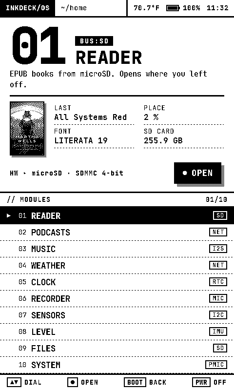
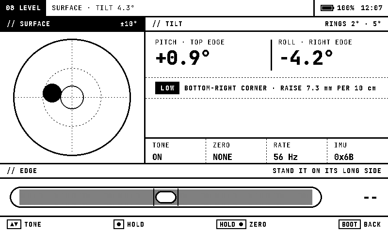

# INKDECK/OS

Firmware for the [Waveshare ESP32-S3-ePaper-3.97](https://www.waveshare.com/esp32-s3-epaper-3.97.htm):
an e-reader, audio player and desk companion on an 800×480 1-bit e-paper panel. It's driven by a
3-way dial, the BOOT key and the PWR key. PlatformIO, Arduino core 3.3 on ESP-IDF 5.5.

  

Screens as the panel draws them, saved over USB with `tools/screenshot.py`.

## Features

Home lists ten modules, each with a live preview. Every screen uses one key language: ▲▼ to
move or adjust, ● for the main action, HOLD ● for the second one, BOOT for back, HOLD BOOT for
Home. Landscape screens (Clock, Level, wide pictures) turn the board so the wheel is on top;
there, rolling it left is ▲ and right is ▼.

| Module | What it does |
| --- | --- |
| **Reader** | EPUB 2/3 from microSD in Literata (three sizes), justified, with drop caps and line breaks at soft hyphens and dashes. Shows pictures (JPEG/PNG, dithered), the table of contents, and the cover as a page and on Home. Honours `display:none`. Resumes each book where you left it, even after a power loss |
| **Podcasts** | RSS feeds over Wi-Fi plus folders of MP3s. Downloads resume after a reset. Playback resumes where you stopped, and played episodes are marked |
| **Music** | MP3 and WAV from the card through the codec and speaker, with a waveform overview, queue and volume. Playback continues on any screen; HOLD BOOT jumps back to the player |
| **Weather** | Open-Meteo forecast: now, 12 hours and 6 days, with a detail sheet per day. Synced hourly (every half hour on USB) and cached for offline use |
| **Clock** | Landscape desk clock: calendar, sunrise and sunset, a weather strip, now-playing, and three alarms. An alarm can boot the board from power-off |
| **Recorder** | Voice memos from the onboard mic as 16 kHz WAV, with a live waveform, input meter and gain. Memos play back on the device with a volume meter (▲▼), and can be deleted |
| **Sensors** | Temperature and humidity with a 24 h sparkline, the IMU, PMIC readings, a live I2C bus scan, and a CSV log to the card |
| **Level** | Landscape bubble level and long-edge vial. Shows which side to raise and by how much, can be zeroed, and beeps when it's level |
| **Files** | Browses the microSD card and the onboard 9.9 MB FAT partition, and opens books, audio, pictures and text. A held dial pages through long folders. **Pictures** (JPEG, PNG) show full screen, dithered, in landscape when they're wider than tall; phone photos come out upright (EXIF orientation), and ▲▼ steps through the folder. ● hides the status and hint bars. JPEGs of any size stream from the card; PNGs up to 2400 px wide and 4 megapixels. **Text**: any file that reads as text (UTF-8, Windows-1252 or UTF-16) opens in the text reader, which scrolls instead of paging: ▲▼ scrolls by a line, a quarter or half a screen (menu), and keeps going while held. Literata or JetBrains Mono in three sizes; hard-wrapped prose (Project Gutenberg) is joined back into paragraphs. The place, size and font are kept per file. A file over 4 MB shows its first 4 MB (less if memory is short) |
| **System** | Battery and charger state, power rails, wake plan, Wi-Fi, memory and OTA slots, and the build running (version and git commit). Also NTP time sync, sleep, reboot, firmware updates over Wi-Fi, and how often the screen does a full refresh (both below) |

**Power**
- PWR shows a sleep screen and powers the board off completely. The e-paper keeps its image,
  and the RTC wakes the board for the next alarm.
- After 10 idle minutes on battery, the board goes to standby: a clock face that the RTC
  redraws every minute, with the room temperature and humidity and the outside weather from
  the saved forecast. `INKDECK_STANDBY_WEATHER_HOURS` in `platformio.ini` has it fetch a new
  forecast every so many hours (0: never). Each wake light-sleeps through the panel refresh
  and runs at 80 MHz once the face is drawn.
- Reading (a book, a text file or a picture) and music don't time out until the battery is low.
- While you read on battery, the board light-sleeps between page turns.
- On USB, PWR shows the clock face instead and the board stays on.

**Display:** screen changes use the fast partial refresh. A full refresh (the black-white flash)
clears the ghosting that partials leave, once they have flipped two screens' worth of pixels
or after 30 of them. System's AUTO FULL REFRESH sets that to 2, 5, 10 or 20 screens, or OFF,
and the setting is kept. The serial log reports each refresh and how much change has built
up since the last full one. HOLD BOOT always does a full refresh.

**Settings:** Wi-Fi, time zone, location and the password for updates over Wi-Fi come from
`.env` at build time (template:
`.env.example`). `inkdeck.ini` in the card's root overrides the time zone and location
without a rebuild (example: [`inkdeck.ini.example`](inkdeck.ini.example)). The board reads it
at startup, and if the card has none, it writes one with every line commented out. Wi-Fi is
never read from the card. `INKDECK_FAHRENHEIT` in `platformio.ini` switches between US and
metric units.

```ini
[clock]
timezone = GMT0BST,M3.5.0/1,M10.5.0   ; a POSIX TZ string, daylight saving rule included
[location]
latitude = 51.48                      ; decimal degrees, north and east positive
longitude = 0.00
```

## Build and flash

The PlatformIO CLI is at `~/.platformio/penv/Scripts/pio.exe` (or use the VS Code extension).

```sh
cp .env.example .env          # optional: Wi-Fi, time zone, location
pio run -t upload             # build and flash over the board's USB-C
pio device monitor            # serial console, 115200
```

If the USB port disappears, hold BOOT while power-cycling the board, then upload again.
`tools/screenshot.py` drives the UI over USB and saves the screen as a PNG. `src/devtools.h`
lists the serial dev commands.

### Updating over Wi-Fi

Once a build with Wi-Fi and an `OTA_PASSWORD` in `.env` is on the board (flash it over USB the
first time), later builds can go over the network:

1. On the board: System → UPDATE OVER WI-FI. It joins the network and listens for 10 minutes
   (each attempt restarts the window), showing its address.
2. On the computer, from the same network:

   ```sh
   pio run -t upload --upload-port inkdeck.local    # or the IP the board shows
   ```

PlatformIO sends a network upload with espota, and `scripts/gen_secrets.py` passes it the
`OTA_PASSWORD` from `.env` (the firmware keeps only its SHA-256). espota has the board connect
back to the computer for the image, so the firewall must let Python accept incoming connections
(macOS asks the first time). espota's debug output prints the password, so don't paste upload
logs anywhere public.

The image goes into the idle OTA slot. Only a complete image that passes its checks switches
the boot slot, so cutting the power or Wi-Fi midway leaves the running firmware in place. The
board then restarts into the new build. The System screen's context line shows the build's git
commit (with `+` for uncommitted changes), so you can see it took. A new build stays on
probation until it gets through `setup()`. If it crashes or resets before then, the bootloader
goes back to the previous one, and System's OTA row says `ROLLED BACK FROM app1`. A USB upload
still works as before and always boots the slot it writes (`app0`).

## More

- [`AGENTS.md`](AGENTS.md): hardware, power architecture, driver notes and gotchas.
- [`docs/ui-design.md`](docs/ui-design.md): the UI spec, one entry per screen, and a link to the
  design canvas.
- [`docs/`](docs/README.md): schematic, datasheets, mechanical files and the vendor wiki.
- [`enclosure/`](enclosure/README.md): a 3D-printable back tray.
