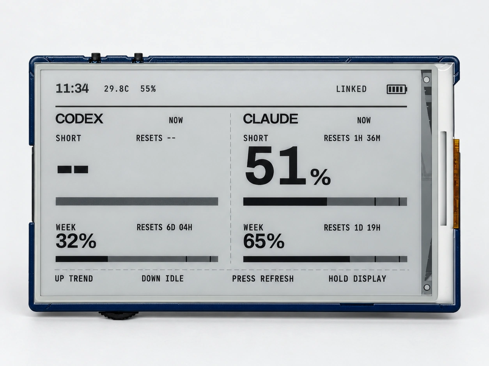
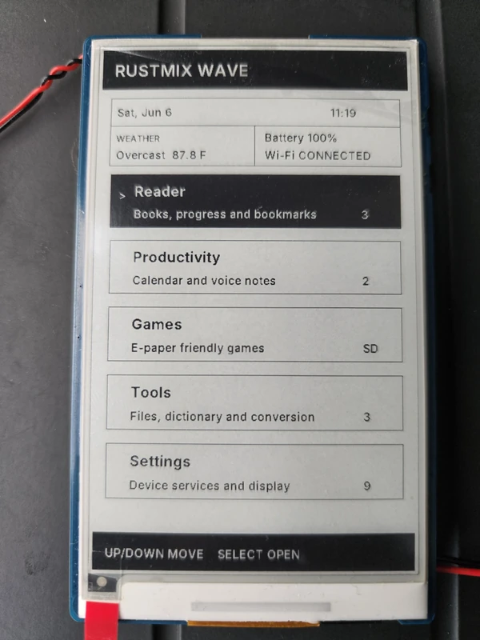

<!-- Source: https://docs.waveshare.com/ESP32-S3-ePaper-3.97/Resources-And-Documents (fetched 2026-11-12) -->

# Resources

## 1. Examples

- [ESP32-S3-ePaper-3.97 Examples (GitHub)](https://github.com/waveshareteam/ESP32-S3-ePaper-3.97)

## 2. Hardware Resources

- [ESP32-S3-ePaper-3.97 Schematic](https://files.waveshare.com/wiki/ESP32-S3-ePaper-3.97/ESP32-S3_e-Paper-3.97-schematic.pdf)
- [ESP32-S3-ePaper-3.97 Structure](https://files.waveshare.com/wiki/ESP32-S3-ePaper-3.97/ESP32-S3-EPAPER-3.97.zip)

## 3. Technical Manuals

- **ESP32-S3 Chip Official Manuals**

  - [Datasheet](https://documentation.espressif.com/esp32-s3_datasheet_en.pdf)
  - [Technical Reference Manual](https://documentation.espressif.com/esp32-s3_technical_reference_manual_en.pdf)
- **Datasheets**

  - [3.97inch e-Paper Datasheet](https://files.waveshare.com/wiki/3.97inch_e-Paper_HAT%2B/3.97inch_e-Paper.pdf)
  - [ES8311 Datasheet](https://files.waveshare.com/wiki/common/ES8311.DS.pdf)
  - [PCF85063 Datasheet](https://files.waveshare.com/wiki/common/Pcf85063atl1118-NdPQpTGE-loeW7GbZ7.pdf)
  - [SHTC3 Datasheet](https://files.waveshare.com/wiki/common/SHTC3_Datasheet.pdf)
  - [TG28 Datasheet](https://files.waveshare.com/wiki/common/TG28_Datasheet_V1.0_en.pdf)

## 4. Software Tools

- [Arduino IDE Official Download Link](https://www.arduino.cc/en/software/)
- [Arduino-ESP32 Offline Component Package](https://drive.google.com/drive/folders/1YhHg8AA_02LFW2OqChk3hbFRV_GVt9Y0)
- [VS Code Official Download Link](https://code.visualstudio.com/download)
- [Flash Download Tool](https://dl.espressif.com/public/flash_download_tool.zip)

## 5. Other Resources

- [ESP32-Arduino Official Documentation](https://docs.espressif.com/projects/arduino-esp32/en/latest/index.html)

## 6. Community Showcase

info

Check out these amazing projects created by the community! Please note these are independently maintained by their creators.

### QuotaFrame

QuotaFrame displays Codex and Claude usage percentages and reset countdowns on the ESP32-S3-ePaper-3.97, with data sent over Bluetooth by its desktop Bridge.

- Website: <https://QuotaFrame.com>
- GitHub: <https://github.com/eMUQI/QuotaFrame>

### ALXV Labs - FolloUp — the device that captures your thoughts in the moment.

FolloUp provides firmware and a 3D-printed enclosure for the Waveshare 3.97-inch e-paper board. It uses Gemini to transcribe and summarize recordings and stores notes on a microSD card.

- YouTube: <https://www.youtube.com/shorts/dGzTLk4jWNE>
- MakerWorld: <https://makerworld.com/en/models/3180226-folloup>
- GitHub: <https://github.com/alxv2016/folloup-sticky/tree/folloup-waveshare>

### CrossMux

[CrossMux](https://crossmux.com/) is an e-reader firmware project based on [CrossPoint Reader](https://github.com/crosspoint-reader/crosspoint-reader), optimized for CJK text and supporting multiple languages.

- Project homepage: <https://crossmux.com/>
- GitHub: <https://github.com/0x1abin/crossmux>

### aimindseye - Rustmix Wave for Waveshare ESP32-S3 E-Paper 3.97

Image source: aimindseye — [rustmix-wave Image](https://raw.githubusercontent.com/aimindseye/rustmix-wave/6feeeb4f5941bf9b899033f713dcc5f2987e8bad/screenshots/homepage.jpg).

Rustmix Wave is ESP32-S3-ePaper-3.97 firmware built with Rust and ESP-IDF. It supports TXT and some reflowable EPUB files, with voice notes, a calendar, a dictionary, and motion-controlled games.

- Reddit: <https://www.reddit.com/r/esp32projects/comments/1tyngwy/rustmix_wave_v100_an_opensource_rust_firmware_for/>
- GitHub: <https://github.com/aimindseye/rustmix-wave>

### clackups - Draftling update: Waveshare ESP32-S3-ePaper-3.97 in printed enclosure

Draftling is text editing firmware with Bluetooth Low Energy (BLE) keyboard input for Markdown and plain text files. The project includes 3D-printable enclosure models and FreeCAD design files for the ESP32-S3-ePaper-3.97.

- YouTube: <https://www.youtube.com/watch?v=QtNKmCt7KFE>
- Github: <https://github.com/clackups/draftling>
- GitHub (CAD): <https://github.com/clackups/draftling/tree/main/3D_Prints/Waveshare_ESP32-S3-ePaper-3.97>

[Give Feedback](https://docs.google.com/forms/d/e/1FAIpQLSfayJEZ5J-dp-3Wq_dkWsVRhNuQ6C79_GNV62mYuFW8Mj6U8Q/viewform)
