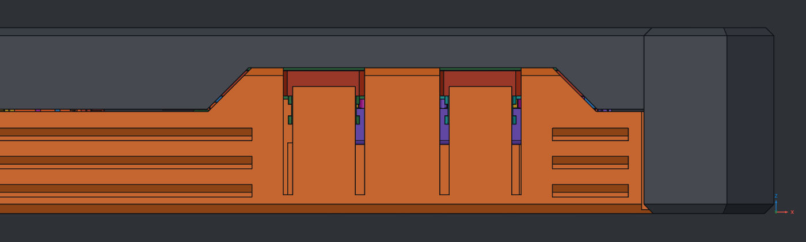
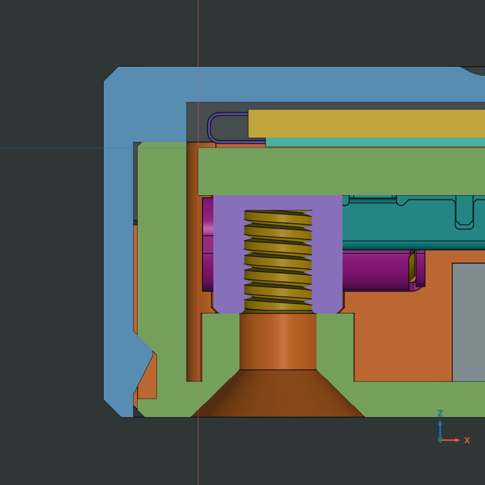
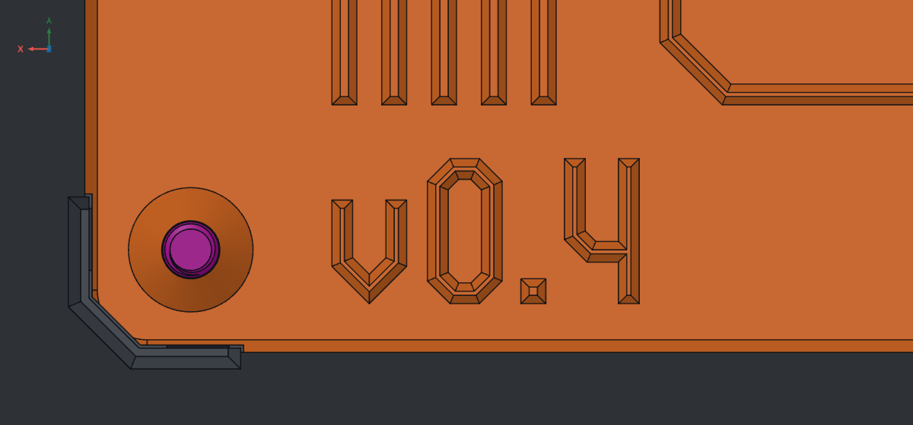
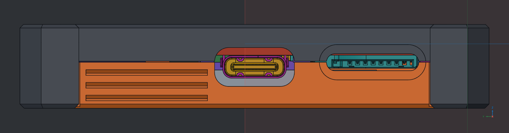
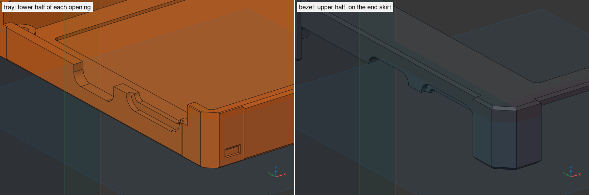

# E-reader enclosure

Enclosure for the Waveshare ESP32-S3-ePaper-3.97, modelled in ScanRuler's Reverse engineer around
Waveshare's own STEP of the board (`docs/mechanical/*.stp`, imported as reference bodies), so
every opening and clearance comes from the real part geometry. The revision is engraved on the
back of the tray (see **Revision**). v0.3 was printed once (2026-11-14), without the engraving.
That print had the screw heads standing proud, a gap above the PCB at the back of the thumbwheel
notch, and a frog that let light through. v0.4 fixes all three (see **Screws**, **Front bezel**
and **Frog**). It also moves the seam down from the glass to just above the PCB, so the bezel's
frame is 2.55 mm deep and about 6.5 times as stiff (see **Stiffer bezel**), and the caps hold
with eight deeper hooks instead of four (see **Hooks**). v0.5 (printed by 2026-11-25) brings the seam
down to z −2.6 on all four sides, except over the PWR / BOOT buttons and the thumbwheel. The
bezel's skirts take the top 2.8 mm of the walls, which makes the frame about 6 times stiffer
again (see **Deeper skirts**). It also repeats the antenna end's three fins on the other three
sides. v0.6 (not printed yet) draws the frog on the back as an outline with a 45° hatch over its
body instead of a dot matrix, which cuts the first layer's retractions from 509 to 125 and drops
the 96 point-sized loops the slicer laid there (see **Frog**). It also lowers the bezel's hooks 0.2 mm so they click all the
way into the tray's grooves, which they didn't quite do on the v0.5 print (see **Hook play**). Earlier designs (v0.1, a two-part shell with a screwed-on bezel; v0.2, the tray alone with
no front) are in git history.

## v0.6: back tray + snap-on front bezel with corner caps (11.86 mm)

| File | What |
| --- | --- |
| `ereader-enclosure.scanruler` | Parametric source: 130 features (1 suppressed), 117 parameters (7 pinned), board STEP, battery dummy, 1 open note |
| `ereader-enclosure.step` | Both parts as solids, `Back tray` and `Bezel` (read back and verified) |
| `back-tray.stl`, `battery-tub.stl`, `front-bezel.stl` | Print meshes of the flatter back ([`concepts/flatter-back/`](concepts/flatter-back/README.md)), not of this model: they replaced v0.6's tray and bezel on 2026-11-26 for a test print. v0.6's are in git history, and its solids in `ereader-enclosure.step` |
| `board_one_body.py`, `board-one-body.step` | Waveshare's board STEP as one light body, to bring into ScanRuler beside the enclosure (Import STEP; it comes in as one body, in this frame, in about 25 s). The PCB, the panel and the standoffs are as drawn; every other part is its outline carried to the board, so it keeps its footprint and height and loses its detail. 3,713 faces, 17.6 MB; the script takes about 6 minutes (`uv run enclosure/board_one_body.py`). The board as drawn (678 bodies) is `docs/mechanical/*.stp` |
| `revision_glyphs.py` | Draws the revision engraving's sketches (`uv run enclosure/revision_glyphs.py OUT_DIR`). Only for a new font, size or place: a revision bump is the parameter `rev` alone (**Revision**) |
| `renders/*.png` | Assembly, the back with the frog, the revision close up, the tray and the bezel apart, the button side's seam, a corner cap, the USB-C / microSD end, the thumbwheel slot, sections through a side hook, an end hook, a button and the wheel |

**Size:** 105.9 × 66.1 mm over the corner caps (the tray alone is 104.3 × 64.5). **11.86 mm**
from the flat back to the bezel's flat front (v0.1 was 14.85). The seam is 6.51 up from the back
(z −2.6) on all four sides between the corner caps. Over the controls and at the corners it's 9.31
up (z 0.2, 0.2 above the PCB's top face). The tray is 9.31 tall there, and the bezel stands 2.55
above it (5.35 where its skirts come down).

**Stiffer bezel.** Until 2026-11-16 the walls stopped level with the panel glass (z 1.35) and the
bezel was a flat frame 1.2 mm thick over the glass (1.4 over the walls), about 6 mm wide on three
sides, round a window 87.4 × 52.84: a thin open frame, easy to bend and twist. Making it thicker on the front
would have made the case thicker, and the back can't give the material up: the back is one flat
face, and the battery stack sets it (display FPC connector 2.0 under the PCB, 0.1 gap, 4.61 cell,
0.8 skin, with the frog in that skin). The 1.2 mm floor beside the battery is thicker than it
needs to be, but thinning it doesn't move a flat back. So the bezel grows down into the case
instead. The walls stop at z 0.2 (`top_z = skirt_pcb_gap`), and the bezel is solid from its front
down to that plane everywhere except a pocket over the glass (**Front bezel**). It takes the top
1.15 mm of the tray's walls and the strip between the walls and the glass, which was empty. The
front, the back and the 11.86 stay where they were. Across the long sides the frame's section
went from 7.1 to 12.1 mm². Its second moment for bending out of the screen's plane went from
0.95 to 6.26 mm⁴ (×6.6; 0.92 to 5.96 on the thumbwheel side). At the antenna end, through the
pry notch, it went from 0.63 to 4.16. The USB-C end already had its end skirt and is unchanged.
Twist stiffness rises about 5× (a Saint-Venant estimate). The bezel weighs 1166 mm³ more and the
tray 572 mm³ less, about 0.75 g of PETG more in all. The new seam is below the tops of the PWR /
BOOT slots, so those slots now run up through the wall top and the bezel closes them (**Printing
the tray**). The cap hooks now flex from the seam; they're covered under **Hooks**. The end
fins stay centred between the back and the seam, so they sit 0.575 lower.

**Deeper skirts (v0.5, 2026-11-24).** The USB-C end already had a skirt down to z −2.6 for its
split openings. v0.5 does the same on the other three sides. Between the corner caps the tray's
walls stop at z −2.6 (`ant_seam_z` at the antenna end, `side_seam_z` on the long sides; both
follow `sd_cz`, so all four match). The bezel carries the walls the rest of the way up as skirts
the full 2 mm thick: `Antenna skirt` and `Side skirt ±Y`, cut from the tray by `Antenna wall
seam` and `Side wall seam ±Y`. Each skirt joins the cap legs at both its ends and stands 0.15
above the tray's wall top (`cap_gap`), like the end skirt. So the bezel now sits on the tray only
at the corners and over the controls. The long sides keep the old seam over the controls, from
`fin_gap_x0` to `fin_gap_x1` (x 69.35–88.55): the PWR / BOOT slots and the button relief on one
side, the thumbwheel notch on the other. The seam climbs to z 0.2 there on 45° ramps: the tray's
ramp reaches the top at `fin_gap_x0`, 1 mm short of the button relief, so the skirt never comes
down where the button stems pass as the board drops in. The skirt's ramp runs parallel to it,
0.15 off it (measured square to the slope). Both ramps face up on their part's print bed. The
frame's second moment for bending out of the screen's plane went from 6.26 to 36.1 mm⁴ across
the long sides (×5.8; 5.96 to 35.5 on the thumbwheel side), and its section from 12.1 to
17.4 mm². At the antenna end it went from 4.16 to 26.6 through the pry notch (×6.4), and 34.2
beside it. Over the controls, 19.2 mm of each long side, it's still 2.55 deep. The bezel weighs
1001 mm³ more and the tray 1165 mm³ less (the new fins take some of that), so the pair is about
0.2 g lighter. The pry notch moved down with the antenna seam into the skirt's underside. Every
cap leg is now joined to a skirt at its free end, as only the USB-C end's were before, and that
stiffens the hooks (**Hooks**).

**Battery:** a 1500 mAh 454261 pouch, measured 62.5 long (with its protection board) and ~4.61
thick, 42 wide by its name. Centred at x 39.85, y 33.8, it spans x 8.6–71.1, y 12.8–54.8, with
0.92 mm to the USB-C socket and 0.96 to the thumbwheel. Length is the tight direction: about
64 mm fits between those two. A cell this size can't miss both the display FPC connector (2.0 mm under the PCB)
and the MX1.25 headers (3.4 mm), so it passes 0.1 mm under the connector (`batt_gap`; 0.3 until
v0.4 gave 0.2 of it to the skin under the frog). With a 0.8 mm skin below (`batt_skin`), that sets
the back face at z −9.11. The thickness is `bottom_z = min(standoff_z - back_t,
batt_top - batt_t - batt_skin)`, so a cell 3.7 mm thick or less saves 1.91 mm.

**Inside.** The floor is 1.2 mm (`floor_skin`), and the battery sits in a pocket 0.4 mm deeper.
Four bosses (Ø5.2) carry the standoffs up to their own height, z −5.6.

**Screws.** 4 × M2.5 × 6 countersunk come through the floor and boss (3.51 mm) into the standoffs.
Each countersink is a 90° cone, Ø6.0 at the back face and 1.6 deep (`csk_d`). An M2.5 countersunk
head (DIN 965, dk 4.7; ISO 10642 style, 5.0) is 1.5 tall, so its cone would come to a sharp edge
at 2.5 + 2 × 1.5 = 5.5. The top 0.4 mm of a real head is a straight band instead. `csk_d` is that
5.5 plus 0.25 a side, so the head sits 0.25 below the back face (FDM prints the cone a little
small, which takes some of that back). The first print had `csk_d` 5.0, and its heads stood about
0.25 proud. The standoffs' threads are blind and end at z −2.1. With the head 0.25 down, a 6 mm
screw reaches z −2.86, so don't go longer. The cone is wider than the boss at the back face, but
the head bears only inside Ø4.7, within the boss. The thinnest skin, between the cone and the
floor beside the boss, is 0.57.

**Fit.** The PCB has 0.25 mm to the wall on both long sides (`clr_side`; these are the
left/right sides in portrait) and 0.4 at the ends (`clr_end`). The button stems stand 0.69 past
the PCB edge. A relief in the inner wall along the button zone (x 70.4–87.6, 0.84 deep) lets
them slide down past the wall as the board drops in.

**How it goes together.** The board drops in face up and four screws come through the back into
its brass standoffs, clamping it onto the bosses. The tray's walls stop at z −2.6, 2.6 mm below
the PCB's top face, except at the corners and over the controls, where they stop 0.2 above it. The
bezel then snaps on over the glass and the walls. Its frame carries the walls the rest of the way
up and fills the strip between them and the glass, and its skirts fill in the tops of all four
walls. Its
four corner caps run down over the tray's corners to the back face, and two hooks inside each one
(one per leg) click into grooves in the tray.

**Front bezel.** One piece, standing on the tray's wall tops at z 0.2 at the corners and over the
controls. Its skirts reach down to z −2.45 everywhere else (**Deeper skirts**). From its front (z 2.75,
`bezel_top`, taken from the glass) down to that plane it is solid everywhere but a pocket over the
glass (`Glass pocket plan`, cut by `Glass relief`). The pocket is the glass outline (`panel_x1`,
`panel_y0`, `panel_y1`) plus 0.25 a side (`glass_clr`). At the USB-C end it runs out to the
inner wall face instead, clear of the flex cable that wraps the board edge there. Its roof is 0.2
above the glass's active area (`glass_gap`), so the glass takes no load: 0.25 mm separates the
bezel from the panel (the glass border is 0.05 lower than the active area), on top and at the
sides. Over the glass the bezel is 1.2 mm thick (`bezel_t`). Round it the frame is 2.55 deep,
with its underside 0.2 above the PCB's top face (`skirt_pcb_gap`), clear of the board margin,
which carries nothing on top. The
window is the panel's active area plus 0.5 mm a side (`aa_*`, `win_margin`): 87.4 × 52.84 with
R0.5 corners and a 0.8 mm 45° chamfer on its front edge (`win_ch`). It hides the PCB margin, the
glass edge and the panel's inactive border, so the frame is 11.6 mm wide at the USB-C end, where
that border is, and 5.3–5.9 elsewhere. The frame keeps the glass 1.4 mm off a table face-down.
Over the thumbwheel the bezel has the tray's flared notch cut through it too, so the slot is open
from the front face to the back. Under the notch's back edge the frame fills the strip above the
PCB margin, between the panel glass edge (y 58.23, `panel_y1`, 0.25 off it) and the PCB edge line
(y 60), down to 0.2 above the board. On the first print that strip showed as a gap above the
board. The frame's face there is the notch's back wall carried straight down, in the same plane as
the PCB edge and the block under the wheel, so the notch stays open and the PCB edge still shows.
A separate `Wheel skirt` did this before the frame went all the way round; it's suppressed in the
tree now, since the frame covers it. At the USB-C end the bezel carries the top of the end wall,
between the corner caps, as a skirt that forms the top halves of the USB-C and microSD openings
(below). The antenna end and the long sides have skirts like it (**Deeper skirts**). They stand
0.25 off the PCB's long edges and 0.4 off its ends.

**Corner caps.** The corners belong to the bezel. Each cap is the chamfered bumper shape
(`bump_l`, `bump_out`, `bump_ch`), one L-shaped wall from the bezel's front down to the back face,
with the same 0.6 mm chamfer round its foot as the back. It's 1.0 mm thick (`cap_t`): 0.8 stands
proud of the tray's sides, as the bumpers did, and 0.2 sits in a recess cut into the tray's
corners, with 0.15 clearance all round (`cap_gap`). Across the 45° corner the cap stays 1.0 mm
thick, and the tray wall behind it is still 1.1 mm at its thinnest. `bump_up` (0) is how far the
caps stand proud of the front: anything above 0 needs supports under the whole front when
printing.

**Hooks.** Eight, one inside each leg of each cap, toward the leg's free end: on the long sides
(`Cap hook`, centred at `hook_x0`) and on the USB-C and antenna ends (`End hook`, at `hook_y0`),
each mirrored to all four corners. The first print had only the four on the long sides, 0.5 deep,
and the joint was a bit flimsy. Each hook is 3 mm wide (`hook_w`) and 0.65 deep (`hook_d`), with a 45°
retaining face, a 0.2 flat (`hook_tip`) and a 1:2 lead-in. It clicks into a groove in the tray's
corner recess. The groove's top is 6.4 mm below the wall top (`hook_l`), at z −6.2, and its 45°
roof runs parallel to the retaining face. The hook sits `hook_play` (0.2) lower, its top at
z −6.4, so with the bezel down the roof stands 0.2 above the retaining face (**Hook play**). Once
in, the hook overlaps the tray by 0.5 (0.35 before). The
groove floor is 0.61 above the back face, and the end grooves leave 1.0 of end wall behind them.
Going on, the cap wall flexes 0.5 mm there (`hook_d` − `cap_gap`). The cap is joined to the frame
above the seam, so it bends over the 6.4 mm below it. As a plain cantilever that's about 1.8 %
strain, and about 1.9 times the force per hook of the first print. With twice the hooks, the
bezel holds nearly four times as hard. Since v0.5 every leg is also joined to a skirt along its
last 1 mm, beside the hook (x or y 4.1–5.1 from the corner's outer faces, with the hook at
1.55–4.55). Over that strip the leg hangs only 3.75 mm below the skirt's foot (z −2.45), and over
that length a plain cantilever would strain 5.3 %, near PETG's yield. Away from the joint the
leg still hangs the full 6.4 from the frame, so the real figure lies between 1.8 and 5.3 %. Only
the USB-C end's two hooks were built like this in v0.4; v0.5 printed all eight so. The corner
stiffens the wall too, so it takes more force than a free tab would; only a test print will say
how much. If the bezel won't go on, or a leg cracks, take `hook_d` down first. Since the caps
bend across the layer lines, **print in PETG**. The 45° faces let a firm pull release the hooks.
To take the bezel off, put a spudger in the pry notch (6 × 1.5 × 0.6, `pry_*`, cut up into the
antenna skirt's underside at the lowered seam) under the middle of the antenna end and lever that
end up. The four hooks there let go first, then the other four. The knobs for a test print
are `hook_d` (grip), `hook_l` (stiffness; up to about 6.5, where the groove floor comes within
0.5 of the back face), `hook_play` (seating) and `cap_gap` (fit). Suppressing `Join end hooks`
and `Cut end grooves` takes the end hooks out.

**Hook play (v0.6).** On the v0.5 print the hooks didn't quite click in: the end hook at the top
right corner (+X +Y, the antenna end's thumbwheel corner, with the thumbwheel edge up) stopped
part way into its groove, and the others weren't all the way in either. All eight hooks and grooves are the same shape mirrored, and the parts
don't overlap anywhere in the model. The cause was the fit itself: until v0.6 the retaining face
met the groove roof with no gap, so the hooks seated only if the bezel came down exactly to its
drawn height. At 0.2 mm layers it doesn't. The tray's 9.31 mm at the corners rounds up to 9.4,
and the frame's 2.55 below the bezel's front rounds up to 2.60, so the bezel rests 0.14 high on
its seats. The two 45° faces print as matching stairs, and the G-code of the v0.5 parts left each
hook 0.14 short of seating, at all eight, before PETG's slightly fat walls and the faces' droop
took it further. On top of that the bezel slice started the caps' outer perimeters right at the
end of four hooks (the end hooks at +X +Y, +X −Y and −X +Y, and the long-side hook at −X −Y). A
seam's bump there sits in the 0.15 gap against the tray, which can leave those hooks worse than
the rest. v0.6 lowers the hooks on the bezel by `hook_play`, 0.2 mm, and leaves the tray as it
was, so a v0.5 tray takes a v0.6 bezel. Each layer of play frees as much sideways, so a hook is
held back by 0.14 − `hook_play` as sliced: 0.2 seats them all with 0.06 to spare. That much is
also how far the bezel can lift before the hooks bear, less what the print takes up. If hooks
still sit short, raise `hook_play` to 0.3. Past that the lowered lead-in closes on the groove's
bottom ledge: 0.112 mm clear at 0.2, 0.075 at 0.3, 0.025 at 0.4.

**Frog.** The sleeping frog from the Sleep screen (`kFrog` in `src/apps/sleep.cpp`) is engraved
in the hatch panel on the back as an outline with a 45° hatch over its body, centred on the
battery. Its ink cells (`#`) sit on a 2 mm grid, each a full 2 mm square joined to its
neighbours. Where two cells touch only at a corner, a 45° join links them, as wide as a straight
stroke (2 mm). The 50 % dither cells (`+`) are hatched: grooves 1.41 mm wide with 1.41 lands,
parallel to the hazard stripes, running on into the outline. The paper inside the sprite (`o`,
the belly) is left flat. The hatch is locked to the cell grid: each groove spans one cell
diagonal. Its edges run midway between the cells' corners, so no edge passes through a corner of
the outline. At a pitch not locked to the grid, some groove edge always grazes a corner, leaving
edges a few µm long. Locked with its edges on the corners, lands met the recess at single points,
which the CAD kernel can't build into a closed solid. The whole frog is one recess, 815 mm² over
52 × 32 mm, with nothing narrower than 0.6 mm and no edge shorter than 0.29. It's 0.2 deep (`frog_d`): one first layer, over the
battery, where the skin is 0.8, so 0.6 (three layers) stays under it. The v0.3 print had a 0.6
skin, and the 0.4 left under the frog let light through. Its walls are straight: a 45° draft does
nothing on one layer, and it made the slicer see the strokes 0.2 narrower. It reads upright with
the device turned over side to side, so the thumbwheel side is up (the render above upside down).
The frog is fixed in its sketch (`Frog plan`, 316 lines), so it doesn't follow the battery
parameters. Cell (row r, column c) of `kFrog` is centred at x 14.85 + 2c, y 18.8 + 2(15 − r), and
the grooves are centred on the lines x − y = 0.05 + 4k. To redraw it, write the lines from a
script and send the whole sketch in one `reverse_feature_update`. Give the `Frog` cut its region
as one point inside the recess, not "all", which would also cut the lands and the belly.

Until v0.6 the frog was a dot matrix: ink cells as 1.5 mm square holes and dither cells as 0.8 mm
dots, 266 holes in all, with 45° walls. Printed, that layer came out with a couple of globs, in
the same places each time. In PrusaSlicer (CORE One HF0.4, PETG, Arachne perimeters) the
tray's first layer took 509 retractions. With elephant-foot compensation at 0.2, the slicer also
laid 96 point-sized loops where the holes' corners met (0.03 mm³ each, the nozzle circling
0.12 mm). They printed one after another on bare bed, before the lines round the holes, and PETG
that small tends to ride off on the nozzle: the likely source of the globs. The hatched frog
slices to 125 retractions and no such loops: four of 0.015 mm³ at the hatch's land tips at
compensation 0.2, none at 0. (The outline alone, briefly in v0.6, sliced to 111.) The cost is on
layer 2, which bridges the recess. The slicer bridges a connected recess in one direction, and
left to itself it picks one nearly level: the mouth line and the other level strokes are then
bridged lengthwise, 31 spans over 10 mm and up to 23 mm, 0.2 above the bed. **Set the tray's
bridging angle to 135°** (across the grooves; PrusaSlicer: right-click the tray → Add settings →
Infill → Bridging angle, with the tray as the model lies, not turned on the bed). The frog is the
tray's only bridging, so nothing else changes. Then the grooves are bridged straight across
(1.4 mm), the level and upright strokes at 45° (2.8 mm), and only the outline's diagonal steps
that run with the bridges are spanned lengthwise: 4 spans over 10 mm, up to 15.3. No span over
the dot matrix was longer than 1.5. The sketch is also far lighter: the dot matrix was 1,862
entities with 3,724 constraints and took minutes to solve.

**Revision.** `v0.6` is engraved on the back, in the free corner below the vent slots. Its
reading-left edge lines up with the outer vent slot (x 90.0), and its baseline and digit tops
with the hazard band (y 0.1–7.1). It reads upright the same way as the frog. It sits on the full
1.2 mm floor, clear of the battery pocket and 3.8 mm from the countersink. It's cut like the other
back grooves: 0.4 deep (`line_d`) with 45° walls (`groove_draft`), strokes 1.0 wide at the face
(the hatch line's width), so 0.8 of floor stays under it and each groove keeps a 0.2 flat at the
bottom. The glyphs are a small font of their own: digits 3.6 × 7.0 on a seven-segment plan, with
45° chamfers on the outer corners like the hatch outline and the caps. Like the frog, the text is
fixed in its sketches, so it doesn't follow the battery parameters the vent slots follow.

The revision is one parameter, `rev` (pinned), engraved as v0.`rev`. ScanRuler's sketches have no
text and its parameters are numbers, so the model picks the digit itself. `Rev digits plan` holds
a strip of all ten digits, 0 at the engraving and each next one `rev_pitch` (6 mm) further along
+X. `Rev digits` extrudes them as bodies of their own, `Rev digit pick` moves them by −`rev` ×
`rev_pitch`, `Rev digit` keeps what lands in `Rev window`, and `Cut rev digit` cuts that digit
from the tray. `Rev prefix` cuts the "v0." straight in. The strip is drawn 0.2 below the back face
and 0.2 fatter a side, so its 45° walls come to the glyph's size at the face. Every digit 0–9
builds. `Rev digit pick` names the ten digit bodies by id (141 to 141.0088): if a new font gives
the strip more or fewer pieces, list them again.

**When it bumps:** in the commit that changes either part's print (`back-tray.stl` or
`front-bezel.stl`), set `rev` to the next number before exporting. That includes a change no one
could see from outside, such as a clearance or a hook. v0.3 was the 2026-11-14 print, and the
changes since (sunk screw heads, the wheel-notch gap closed, the frog turned, the stiffer bezel,
eight hooks, the thicker skin) make v0.4, the deeper skirts and the fins all round make v0.5, and
the hatched frog and the hook play make v0.6. Only the tray is marked, so a bezel printed on its own
carries no revision. One digit runs to v0.9. Past that, cut a second digit window or go to v1.0
(the "v0." comes from `revision_glyphs.py`).

`revision_glyphs.py` draws `Rev prefix plan`, `Rev digits plan` and the window from its constants
(font, size, place). Run it only to change those, and send each sketch with
`reverse_feature_update`, with the region points it writes as the extrudes' `regions`. Not "all":
that also takes the counters inside 0, 6, 8 and 9 as regions, and cuts them out.

**Thumbwheel slot.** The wheel is clicked by pushing its rim straight in, and the rim stands
only 0.16 mm past the outer wall. So the notch runs the full height of the case, from the bezel's
front to the back face, and nothing is left under the wheel for a thumb to land on. It keeps the
notch's flare: 10.8 mm wide at the PCB edge line (y 60), 13.6 at the outer face. A solid block
under the wheel (`wheel_back`, reaching 2.5 mm in from the inner wall) closes the slot off from
the battery bay. Its face at y 60 is the slot's back wall, from the back face up to z −4.6,
0.4 mm under the wheel. Above the wheel the same y 60 plane carries on as the PCB edge and then
the bezel's frame (see **Front bezel**), so the slot's back wall is one plane from the
back face to the bezel's front, open only where the wheel and the PCB edge show. The 0.6 mm
back-edge chamfer runs round the slot too. The slot follows
the notch parameters (`wheel_*`). The cost is stiffness: that side wall is open for its full
height there, so only the back plate and the block hold it together.

**USB-C and microSD openings.** Both are in the end wall, and each is formed half by the tray and
half by the bezel, so neither part has a hole with a roof to print. Between the corner caps the
tray's end wall stops at z −2.6, the microSD slot's centre line (`sd_cz`). Above that, the bezel
carries the wall as a skirt the full 2 mm thick, joined to both cap legs and 0.15 clear of the
tray (`cap_gap`). The parting line runs through both openings where their sides are vertical, so
each part has an open U. The tray holds the bottom halves with their bottom curves, and the skirt
holds the top halves with their top curves. Each curve then faces up on its part's print bed. The
openings are the same full rounded shapes as before, apart from the 0.15 parting gap.

The USB-C opening is 11.25 × 5.5 with R2 corners: a measured Apple USB-C plug body (10.25 × 4.5)
plus 0.5 a side (`usb_w`, `usb_h`, with the measurement in their expressions). That is smaller than
the USB-C spec's largest plug body (12.35 × 6.5), so a cable with a fatter plug may not seat; to
take any cable, set them back to 12.4 × 6.6. It's centred on the socket (y 30, z −3.27, measured
from the board STEP) with 1.16 mm to the socket shell all round. The microSD slot is 13 × 2.4 in a
15 × 5 fingernail recess 1 mm deep (`sd_*`). Over the USB-C, the skirt still closes the wall above
the socket, where the panel's flex cable wraps the board edge (0.72 mm away). The features are
`End wall seam` (tray) and `End skirt` with the `Skirt *` cuts (bezel). The cuts reuse the tray's
`USB plan` and `SD plan` sketches, so both halves follow the same parameters.

1. Plug the battery into `BAT`, and tape it into the pocket in the floor.
2. Drop the board in face up, letting the wheel slide down its notch.
3. Fit 4 × M2.5 × 6 countersunk screws (DIN 965 / ISO 10642 style, head ≤ 5.0 mm) from the back. Not longer than 6: the standoff threads are blind.
4. Press the bezel straight down over the glass until all eight hooks click (two in each corner).

**Printing the tray:** back face on the bed, no supports. Everything is laid out for that:
- The back is flat. Its decoration is inward grooves with 45° walls (`groove_draft`), so each layer steps in by at most its own height and nothing bridges. That covers the hatch outline, the hazard stripes, the vent slots and the revision.
- The fins on all four sides have flat floors and 45° ceilings.
- Between the corner caps the walls stop at z −2.6, with 45° ramps up to the full height over the controls, so nothing overhangs at the seam.
- The thumbwheel slot runs straight down to the bed, so its walls are vertical and nothing overhangs.
- The corner recesses are vertical, and the hook grooves in them have 45° roofs.
- The end wall stops at the middle of the USB-C and microSD openings, so they're open Us with their curves facing up. The bezel's skirt makes their tops.
- The frog is a 0.2 mm recess in the first layer, 2 mm strokes and 1.41 mm hatch grooves with straight walls. The second layer bridges it, so **set the tray's bridging angle to 135°**, across the grooves: left to the slicer it bridges the level strokes lengthwise, up to 23 mm (**Frog**).
- The countersinks are 45° cones opening onto the bed (Ø6.0 there, `csk_d`). The 0.6 mm back-edge chamfer also hides elephant's foot, so set PrusaSlicer's elephant-foot compensation (Print Settings → Advanced → Slicing) to 0 for the tray: at 0.2 it leaves four point-sized extrusions at the frog's hatch.
- The PWR / BOOT flexures stand upright, rooted at the floor, so the tab never overhangs. Each tab is 4 × 6.9 × 0.8 mm (`tab_w`, `tab_top`, `tab_t`), and its nub has a 45° underside and sits 0.15 from the stem (`btn_gap`). An upright tab bends across the layer lines, so print it in **PETG**, or expect PLA to crack at the root.
- The slots round the two tabs run up through the wall top, and the bezel closes them from above, so they need no bridge: the frog is the only bridging left. Each tab has 1.2 mm of room above its free end.

**Printing the bezel:** front face on the bed, no supports. The front is flat. The window
chamfer and the 0.5 mm outer chamfer are 45°. The corner caps stand straight up 11.86 mm, their
hooks' retaining faces are 45°, and the chamfers on their feet face up. The skirts stand
straight up off the underside on all four sides. The USB-C end's holds the top halves of the openings as upward-facing curves, and the long sides' end in 45° ramps facing up by the controls. The
frame stands straight up 2.55 mm off the bed all round, with a flat top (its underside when
fitted). The glass pocket (1.35 deep) and the pry notch are open pockets on top. Print it in
**PETG**, so the caps flex rather than crack. Keep the seam off the hooks: with the seam set to
Aligned, PrusaSlicer starts the caps' outer perimeters at the end of four hooks (**Hook play**).
Paint a seam blocker over the caps' inner faces round the hooks, or an enforcer on each cap's
45° outer corner.

**Checked in ScanRuler** (model only):
- **Clearances:** button stems to nubs and relief 0.15, PCB to walls 0.24, wheel 0.37, panel to tray 1.59 and to bezel 0.25, USB-C socket shell to its opening 1.16. The MX1.25 headers and ESP32 module are ~3 mm above the floor.
- **Battery:** sits on the pocket floor, 0.10 under the display FPC connector, 0.96 from the wheel, 0.92 from USB-C. A swelling pouch has only that 0.1 mm above it.
- **Contact:** the tray touches the board only at the four standoff ends. The bezel touches nothing on the board: its frame is 0.20 above the PCB's top face all round, 0.40 from the PCB's ends at the end skirts, 0.25 from its long edges at the side skirts, 0.25 off the panel glass, 0.66 from the nearest standoff and 2.8 above the wheel. It touches the tray only on the wall tops at the corners and over the controls. The hooks' retaining faces stand 0.2 below their groove roofs (`hook_play`), and the caps and the skirts 0.15 off the tray everywhere else.
- **Solids:** both valid and closed, with no slivers or voids, and the STEP round trip is exact. The only steps between features the check flags are the frog's intended 0.2 mm depth on the tray; the bezel has none.

**Openings:** USB-C 11.25 × 5.5, for Apple-size plugs (the panel's flex cable wraps the board edge
just above it, so the skirt keeps the wall closed over the top). microSD slot with a 15 mm
fingernail recess. Both are split between the tray and the bezel. Flared thumbwheel slot, open from the bezel's front to the back. Pry notch under the bezel.

**Decoration** (each one is a feature of its own, so any can be suppressed):
- Chamfered corner caps on the bezel (`bump_l`, `bump_out`, `bump_ch`, `cap_t`).
- Three fins on each side, all at one height (z −8.06 to −3.66), centred between the back face and the z −2.6 seam (`fin_*`, `*_fin_zc`). They stop 1 mm short of each corner cap. On the long sides they break for the controls (`fin_gap_x0` to `fin_gap_x1`), leaving a 4.85 mm run between the controls and the antenna end's caps. At the USB-C end they run only between the USB-C opening and the cap (`USB end fins`, y 36.6–53.75), since the openings fill the rest.
- On the back: a chamfered hatch outline round the battery (`hatch_*`, `line_*`), five vent slots spanning the hatch's height beside it (`vent_*`), and a band of 45° hazard stripes below it (`haz_*`). All 0.4 mm deep, and they follow the battery parameters.
- The frog, outlined and hatched, inside the hatch outline (`frog_d`, **Frog**).
- The revision, v0.`rev`, below the vent slots (**Revision**).
- Chamfers: 0.5 mm on the bezel's front outer edges, 0.5 on the tray's top outer edges where they're still at z 0.2: over the controls and inside the corner caps. The lowered seam has the 0.15 parting gap instead, 0.6 round the back (cap feet and thumbwheel slot included).

**Pinned parameters:** `rev` 6, `batt_t` 4.61, `bump_up` 0, `bump_l` 7.5, `wall_t` 2.0, `hook_play` 0.2, `frog_d` 0.2.

**Open question** (pinned as a note in the project): **screws**. This assumes the standoffs are
fixed to the PCB. The panel glass covers their holes, so they must be.

**Not done yet:** speaker mount and grille, mic port, raised labels, a test print for
tolerances (`clr_side`, `clr_end`, `btn_gap`, `tab_t`, `cap_gap`, `hook_d` and `hook_play` are the knobs).

**Flatter back:** a back that hugs the battery: 9.95 mm everywhere but a battery tub, in three
parts that print without supports, with bevelled edges: [`concepts/flatter-back/`](concepts/flatter-back/README.md).
Its meshes are the STLs in this folder. Printed once (2026-11-26): the tub's latches were too
flimsy, and it now holds with solid lugs, not printed yet. This model stays v0.6.
