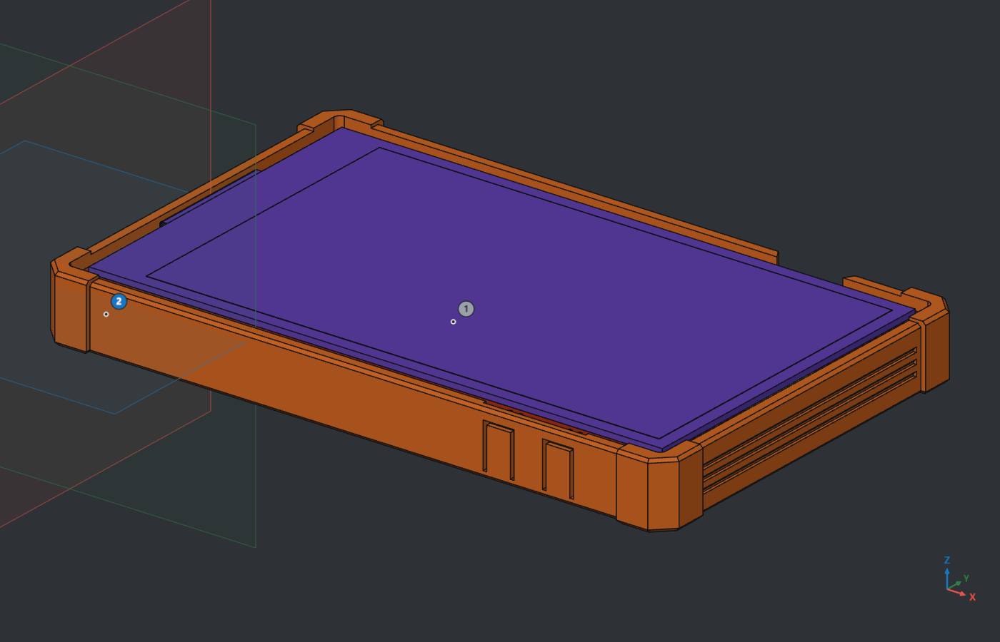
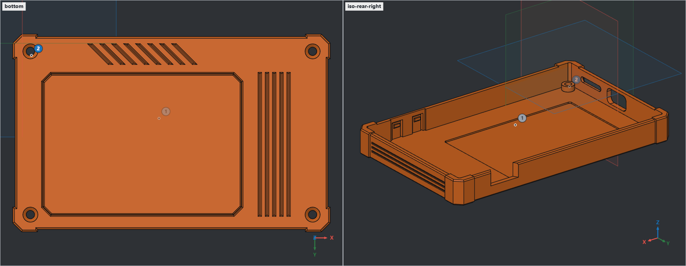

# E-reader enclosure

Enclosures for the Waveshare ESP32-S3-ePaper-3.97, modelled in ScanRuler's Reverse engineer
around Waveshare's own STEP of the board (`docs/mechanical/*.stp`, imported as reference bodies),
so every opening and clearance comes from the real part geometry. **v0.2 is current**; v0.1 is
kept below for reference. Neither has been printed.

## v0.2: one-piece back tray, no front, flat back (10.46 mm)

| File | What |
| --- | --- |
| `ereader-enclosure-v0.2.scanruler` | Parametric source: 46 features, 80 parameters (4 pinned), board STEP, battery dummy, 1 open note |
| `ereader-enclosure-v0.2.step` | The tray as a solid (read back and verified) |
| `v0.2-back-tray.stl` | Print mesh (0.02 mm chord) |
| `renders/v0.2_*.png` | Assembly, back and inside, section through a button |

**Size:** 105.9 × 66.1 mm over the bumpers. **10.46 mm** from glass to the flat back,
10.96 mm at the corner bumpers (v0.1: 14.85).

**Battery:** a 1500 mAh 454261 pouch (61 × 42, measured ~4.61 thick), centred at x 40.0,
y 33.8. It spans x 9.5–70.5, y 12.8–54.8, with 1.8 mm to the USB-C socket and 1.5 to the
thumbwheel. A cell this size can't miss both the display FPC connector (2.0 mm under the PCB)
and the MX1.25 headers (3.4 mm), so it passes 0.3 mm under the connector. With a 0.6 mm skin
below, that sets the back face at z −9.11. The thickness is `bottom_z = min(standoff_z - back_t,
batt_top - batt_t - batt_skin)`, so a cell 3.7 mm thick or less gives 8.55 mm.

**Inside.** The floor is 1.2 mm (`floor_skin`), and the battery sits in a pocket 0.6 mm deeper.
Four bosses (Ø5.2) carry the standoffs up to their own height, z −5.6.

**Fit.** The PCB has 0.25 mm to the wall on both long sides (`clr_side`; these are the
left/right sides in portrait) and 0.4 at the ends (`clr_end`). The button stems stand 0.69 past
the PCB edge. A relief in the inner wall along the button zone (x 70.4–87.6, 0.84 deep) lets
them slide down past the wall as the board drops in.

**How it goes together.** The board drops in face up and four screws come through the back into
its brass standoffs, clamping it onto the bosses. Nothing covers the front. The walls stop level
with the panel glass, and the corner bumpers stand 0.5 mm proud so the glass never touches a
table when it's face down. The thumbwheel notch is open at the top.

1. Plug the battery into `BAT`, and tape it into the pocket in the floor.
2. Drop the board in face up, letting the wheel slide down its notch.
3. Fit 4 × M2.5 × 6 countersunk screws (DIN 965 / ISO 10642 style, head ≤ 5.0 mm) from the back.

**Printing:** back face on the bed, no supports. Everything is laid out for that:
- The back is flat. Its decoration is inward grooves with 45° walls (`groove_draft`), so each layer steps in by at most its own height and nothing bridges. That covers the hatch outline, the hazard stripes and the vent slots.
- The end fins have flat floors and 45° ceilings.
- The countersinks are 45° cones opening onto the bed. The 0.6 mm back-edge chamfer also hides elephant's foot.
- The PWR / BOOT flexures stand upright, rooted at the floor, so the tab never overhangs. Each tab is 4 × 6.9 × 0.8 mm (`tab_w`, `tab_top`, `tab_t`), and its nub has a 45° underside and sits 0.15 from the stem (`btn_gap`). An upright tab bends across the layer lines, so print it in **PETG**, or expect PLA to crack at the root.
- The remaining bridges: USB-C opening top (~8 mm flat), microSD slot and recess tops (≤ 10 mm), and the slot over each tab (5.2 mm). All are ordinary bridges.

**Checked in ScanRuler** (model only):
- **Clearances:** button stems to nubs and relief 0.15, PCB to walls 0.24, wheel 0.37, panel 0.72, USB-C 1.80. The MX1.25 headers and ESP32 module are ~3 mm above the floor.
- **Battery:** sits on the pocket floor, 0.30 under the display FPC connector, 1.55 from the wheel, 1.82 from USB-C. A swelling pouch has only that 0.3 mm above it.
- **Contact:** the tray touches the board only at the four standoff ends.
- **Solid:** valid, closed, no slivers or steps between features, STEP round trip exact.

**Openings:** USB-C 12.4 × 6.6 (overmolds up to ~6.5 mm; the panel's flex cable wraps the board
edge just above it, so the wall stays closed over the top). microSD slot with a 15 mm fingernail
recess. Flared thumbwheel notch.

**Decoration** (each one is a feature of its own, so any can be suppressed):
- Chamfered corner bumpers (`bump_l`, `bump_out`, `bump_up`, `bump_ch`).
- Three fins on the antenna end (`fin_*`).
- On the back: a chamfered hatch outline round the battery (`hatch_*`, `line_*`), five vent slots spanning the hatch's height beside it (`vent_*`), and a band of 45° hazard stripes below it (`haz_*`). All 0.4 mm deep, and they follow the battery parameters.
- 0.5 mm chamfer on the top outer edges, 0.6 mm round the back.

**Pinned parameters:** `batt_t` 4.61, `bump_up` 0.5, `bump_l` 7.5, `wall_t` 2.0.

**Open question** (pinned as a note in the project): **screws**. This assumes the standoffs are
fixed to the PCB. The panel glass covers their holes, so they must be.

**Not done yet:** speaker mount and grille, mic port, raised labels, a test print for
tolerances (`clr_side`, `clr_end`, `btn_gap` and `tab_t` are the knobs). The PCB margin
(1.2–2 mm) between the glass edge and the walls is visible from the front.

---

## v0.1: two-part shell with bezel (14.85 mm)

| File | What |
| --- | --- |
| `ereader-enclosure.scanruler` | Parametric source: 46 features, 48 parameters, board STEP, 3 open notes. Open in scanruler.com |
| `ereader-enclosure.step` | Front shell + back plate as solids (read back and verified) |
| `front-shell.stl`, `back-plate.stl` | Print meshes (0.02 mm chord) |
| `renders/` | Reference pictures |

**Size:** 104.3 × 65.3 × 14.85 mm. Display window 87.4 × 52.8 (active area + 0.5 mm per side).

### How it goes together

- **Front shell**: bezel and side walls in one piece. The PCB's top face seats on an internal
  ledge at the PCB margin outside the panel glass. The glass floats 0.2 mm under the bezel and
  never takes load.
- **Back plate**: 1.6 mm plate with an alignment lip, a battery bay with corner stops, and four
  bosses that land on the board's own brass standoffs.
- **Fasteners**: 4 × M2.5×8 button-head screws (ISO 7380), driven from the back through the bosses
  into the standoffs. They clamp the stack: PCB → ledge, back plate → wall rim.
- **Thumbwheel** (the onboard 3-way rotary): its wheel sticks out 2.4 mm past the PCB edge. The
  wall slot is open at the bottom so the board drops straight in. A tongue on the back plate then
  closes the slot under the wheel. A spherical scoop (R8) around it gives the thumb room.
- **PWR / BOOT**: 8 × 4 mm flexure tabs cut into the side wall, thinned to 1.0 mm (`tab_t`).
  Each has a nub 0.21 mm off its tact-switch stem. PWR is the one nearer the corner (x 84), BOOT
  is at x 74.
- **USB-C**: 12.4 × 7.2 slot, sized for cable overmolds. **microSD**: 13 × 2.4 slot inside a
  1 mm-deep fingernail recess.

**Assembly:**
1. Plug the battery into `BAT`.
2. Tape the battery into the stops on the back plate.
3. Lay the board face-down in the front shell, letting the wheel slide down its slot.
4. Fit the back plate.
5. Fit the 4 screws.

Checked in ScanRuler (model only, nothing printed yet):
- **Clearances:** side buttons 0.21 mm, panel to bezel 0.22, wheel to shell 0.35, wheel to tongue 0.40, battery to lowest board part 0.82.
- **Contact:** the parts touch only at the PCB ledge and the standoff/boss faces.
- **Solids:** both bodies are clean (no slivers, steps or voids) and pass a STEP round trip.

### Parameters worth knowing

All in the `.scanruler` file; the starred ones are pinned in its panel.

| Name | Value | Drives |
| --- | --- | --- |
| `batt_t` ★ | 5.0 | Battery thickness → enclosure depth (`floor_z = comp_low − batt_gap − batt_t`) |
| `batt_l`, `batt_w` | 50, 34 | Battery stop frame (503450 pouch assumed) |
| `bezel_t` ★ | 1.2 | Bezel over the panel → front face height |
| `corner_r` ★ | 5 | Outer plan corner radius |
| `wall_t` | 2.0 | Side wall thickness |
| `clr`, `clr_btn` | 0.4, 0.9 | PCB-to-wall gap; the button side is wider for the switch tips |
| `glass_clr`, `panel_gap` | 0.3, 0.2 | Panel pocket fit |
| `tab_t` | 1.0 | Button flexure stiffness |
| `usb_w`/`usb_h`, `sd_w`/`sd_h` | 12.4/7.2, 13/2.4 | Side openings |
| `lip_clr`, `tongue_clr` | 0.15, 0.15 | Fit between the two printed parts. Tune to your printer |

A flex test (`batt_t` 3.5, `bezel_t` 1.5) rebuilt all 46 features cleanly.

### Printing

- **Front shell**: front face on the bed. The window chamfer and the button slots print without
  support.
- **Back plate**: outer face on the bed.
- PETG gives softer button flexures than PLA (estimate ~3 N to press in PLA at `tab_t` 1.0).

### Open questions (also pinned as notes in the project)

1. **Battery**: 503450 (5 × 34 × 50, ~1000 mAh) assumed. Check the MX1.25 polarity before
   plugging in.
2. **Standoffs**: assumed M2.5 female at the free end.
3. **Button feel**: unknown until printed. Adjust `tab_t`.

### Not done yet

- Speaker mount and grille (`SPK` header), mic port, RTC backup cell.
- Button labels and a parting-line reveal.
- A test print for tolerances.
- **Battery placement:** the battery sits under the board, which sets the 14.85 mm thickness. A
  thinner, longer layout would move the battery into a grip "chin" past one short end. The
  board's wide-border end (x = 0, USB-C side) suits that.
