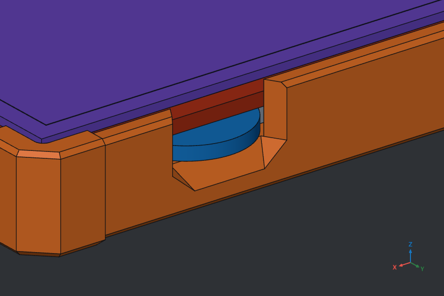

# E-reader enclosure

Enclosure for the Waveshare ESP32-S3-ePaper-3.97, modelled in ScanRuler's Reverse engineer around
Waveshare's own STEP of the board (`docs/mechanical/*.stp`, imported as reference bodies), so
every opening and clearance comes from the real part geometry. Not printed yet. Earlier designs
(v0.1, a two-part shell with a bezel) are in git history.

## Back tray (v0.2): one piece, no front, flat back (10.46 mm)

| File | What |
| --- | --- |
| `ereader-enclosure.scanruler` | Parametric source: 50 features, 81 parameters (4 pinned), board STEP, battery dummy, 1 open note |
| `ereader-enclosure.step` | The tray as a solid (read back and verified) |
| `back-tray.stl` | Print mesh (0.02 mm chord) |
| `renders/*.png` | Assembly, back and inside, thumbwheel scoop, sections through a button and through the wheel |

**Size:** 105.9 × 66.1 mm over the bumpers. **10.46 mm** from glass to the flat back,
10.96 mm at the corner bumpers (v0.1 was 14.85).

**Battery:** a 1500 mAh 454261 pouch, measured 62.5 long (with its protection board) and ~4.61
thick, 42 wide by its name. Centred at x 39.85, y 33.8, it spans x 8.6–71.1, y 12.8–54.8, with
0.92 mm to the USB-C socket and 0.96 to the thumbwheel. Length is the tight direction: about
64 mm fits between those two. A cell this size can't miss both the display FPC connector (2.0 mm under the PCB)
and the MX1.25 headers (3.4 mm), so it passes 0.3 mm under the connector. With a 0.6 mm skin
below, that sets the back face at z −9.11. The thickness is `bottom_z = min(standoff_z - back_t,
batt_top - batt_t - batt_skin)`, so a cell 3.7 mm thick or less gives 8.55 mm.

**Inside.** The floor is 1.2 mm (`floor_skin`), and the battery sits in a pocket 0.6 mm deeper.
Four bosses (Ø5.2) carry the standoffs up to their own height, z −5.6.

**Fit.** The PCB has 0.25 mm to the wall on both long sides (`clr_side`; these are the
left/right sides in portrait) and 0.4 at the ends (`clr_end`). The button stems stand 0.69 past
the PCB edge. A relief in the inner wall along the button zone (x 70.4–87.6, 0.84 deep) lets
them slide down past the wall as the board drops in.

**How it goes together.** The board drops in face up and four screws come through the back into
its brass standoffs, clamping it onto the bosses. Nothing covers the front. The walls stop level
with the panel glass, and the corner bumpers stand 0.5 mm proud so the glass never touches a
table when it's face down. The thumbwheel notch is open at the top.

**Thumbwheel scoop.** The wheel is clicked by pushing its rim straight in. The rim stands only
0.16 mm past the outer wall, and the wall used to carry on 0.4 mm below it, so a thumb landed on
the wall before the switch moved. Now a 45° scoop cuts the wall away under the notch. It starts
at the PCB edge line (y 60) on the notch floor (z −4.6) and runs down and out to the outer face
at z −6.85. Its sides slope in at 45° too, so on the outer face it is a trapezoid about 13.6 mm
wide at the top and 8.3 at the bottom. A solid block under the wheel keeps the material behind
the slope. It reaches 2.5 mm in from the inner wall (`scoop_back`), from the floor up to the
notch floor, and still sits 0.4 mm under the wheel. The scoop follows the notch parameters
(`wheel_*`).

1. Plug the battery into `BAT`, and tape it into the pocket in the floor.
2. Drop the board in face up, letting the wheel slide down its notch.
3. Fit 4 × M2.5 × 6 countersunk screws (DIN 965 / ISO 10642 style, head ≤ 5.0 mm) from the back.

**Printing:** back face on the bed, no supports. Everything is laid out for that:
- The back is flat. Its decoration is inward grooves with 45° walls (`groove_draft`), so each layer steps in by at most its own height and nothing bridges. That covers the hatch outline, the hazard stripes and the vent slots.
- The end fins have flat floors and 45° ceilings.
- Every face of the thumbwheel scoop slopes at 45° and faces up.
- The countersinks are 45° cones opening onto the bed. The 0.6 mm back-edge chamfer also hides elephant's foot.
- The PWR / BOOT flexures stand upright, rooted at the floor, so the tab never overhangs. Each tab is 4 × 6.9 × 0.8 mm (`tab_w`, `tab_top`, `tab_t`), and its nub has a 45° underside and sits 0.15 from the stem (`btn_gap`). An upright tab bends across the layer lines, so print it in **PETG**, or expect PLA to crack at the root.
- The remaining bridges: USB-C opening top (~8 mm flat), microSD slot and recess tops (≤ 10 mm), and the slot over each tab (5.2 mm). All are ordinary bridges.

**Checked in ScanRuler** (model only):
- **Clearances:** button stems to nubs and relief 0.15, PCB to walls 0.24, wheel 0.37, panel 0.72, USB-C 1.80. The MX1.25 headers and ESP32 module are ~3 mm above the floor.
- **Battery:** sits on the pocket floor, 0.30 under the display FPC connector, 0.96 from the wheel, 0.92 from USB-C. A swelling pouch has only that 0.3 mm above it.
- **Contact:** the tray touches the board only at the four standoff ends.
- **Solid:** valid, closed, no slivers or steps between features, STEP round trip exact.

**Openings:** USB-C 12.4 × 6.6 (overmolds up to ~6.5 mm; the panel's flex cable wraps the board
edge just above it, so the wall stays closed over the top). microSD slot with a 15 mm fingernail
recess. Flared thumbwheel notch with the thumb scoop under it.

**Decoration** (each one is a feature of its own, so any can be suppressed):
- Chamfered corner bumpers (`bump_l`, `bump_out`, `bump_up`, `bump_ch`).
- Three fins on the antenna end (`fin_*`).
- On the back: a chamfered hatch outline round the battery (`hatch_*`, `line_*`), five vent slots spanning the hatch's height beside it (`vent_*`), and a band of 45° hazard stripes below it (`haz_*`). All 0.4 mm deep, and they follow the battery parameters.
- 0.5 mm chamfer on the top outer edges, 0.6 mm round the back.

**Pinned parameters:** `batt_t` 4.61, `bump_up` 0.5, `bump_l` 7.5, `wall_t` 2.0.

**Open question** (pinned as a note in the project): **screws**. This assumes the standoffs are
fixed to the PCB. The panel glass covers their holes, so they must be.

**Not done yet:** speaker mount and grille, mic port, raised labels, a test print for
tolerances (`clr_side`, `clr_end`, `btn_gap` and `tab_t` are the knobs). The PCB margin
(1.2–2 mm) between the glass edge and the walls is visible from the front.
