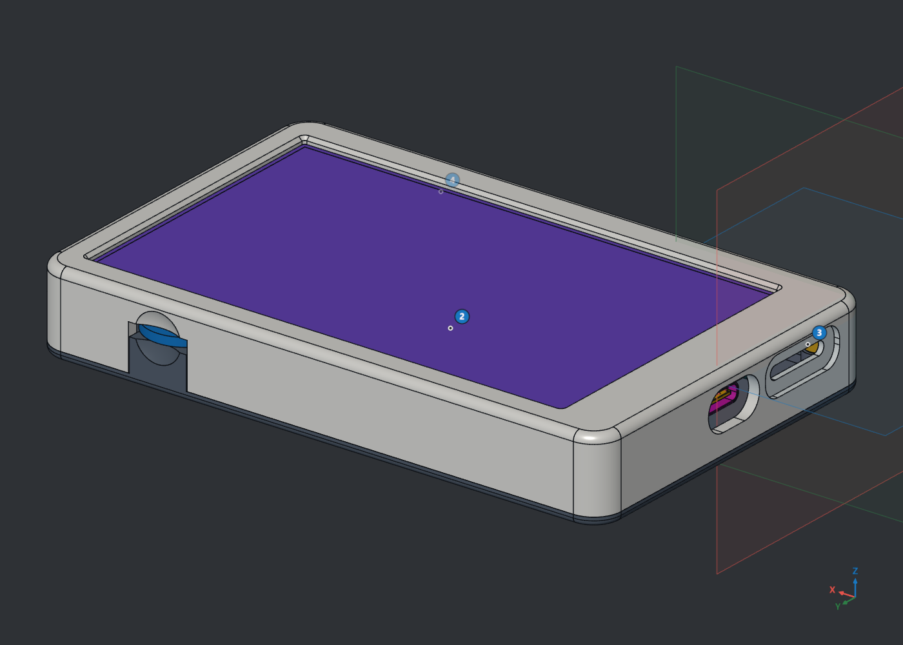

# E-reader enclosure (v0.1, unprinted)

Two-part enclosure for the Waveshare ESP32-S3-ePaper-3.97, modelled in ScanRuler's Reverse
engineer around Waveshare's own STEP of the board (`docs/mechanical/*.stp`, imported as
reference bodies), so every opening and clearance comes from the real part geometry.

| File | What |
| --- | --- |
| `ereader-enclosure.scanruler` | Parametric source: 46 features, 48 parameters, board STEP, 3 open notes. Open in scanruler.com |
| `ereader-enclosure.step` | Front shell + back plate as solids (read back and verified) |
| `front-shell.stl`, `back-plate.stl` | Print meshes (0.02 mm chord) |
| `renders/` | Reference pictures |

**Size:** 104.3 × 65.3 × 14.85 mm. Display window 87.4 × 52.8 (active area + 0.5 mm per side).

## How it goes together

- **Front shell**: bezel and side walls in one piece. The PCB's top face seats on an internal
  ledge at the PCB margin outside the panel glass. The glass floats 0.2 mm under the bezel and
  never takes load.
- **Back plate**: 1.6 mm plate with an alignment lip, a battery bay with corner stops, and four
  bosses that land on the board's own brass standoffs.
- **Fasteners**: 4 × M2.5×8 button-head screws (ISO 7380), driven from the back through the bosses
  into the standoffs. They clamp the stack: PCB → ledge, back plate → wall rim.
- **Thumbwheel** (the onboard 3-way rotary): its wheel sticks out 2.4 mm past the PCB edge. The
  wall slot is open at the bottom so the board drops straight in. A tongue on the back plate then
  closes the slot under the wheel. A spherical scoop (R8) around it gives the thumb room.
- **PWR / BOOT**: 8 × 4 mm flexure tabs cut into the side wall, thinned to 1.0 mm (`tab_t`).
  Each has a nub 0.21 mm off its tact-switch stem. PWR is the one nearer the corner (x 84), BOOT
  is at x 74.
- **USB-C**: 12.4 × 7.2 slot, sized for cable overmolds. **microSD**: 13 × 2.4 slot inside a
  1 mm-deep fingernail recess.

**Assembly:**
1. Plug the battery into `BAT`.
2. Tape the battery into the stops on the back plate.
3. Lay the board face-down in the front shell, letting the wheel slide down its slot.
4. Fit the back plate.
5. Fit the 4 screws.

Checked in ScanRuler (model only, nothing printed yet):
- **Clearances:** side buttons 0.21 mm, panel to bezel 0.22, wheel to shell 0.35, wheel to tongue 0.40, battery to lowest board part 0.82.
- **Contact:** the parts touch only at the PCB ledge and the standoff/boss faces.
- **Solids:** both bodies are clean (no slivers, steps or voids) and pass a STEP round trip.

## Parameters worth knowing

All in the `.scanruler` file; the starred ones are pinned in its panel.

| Name | Value | Drives |
| --- | --- | --- |
| `batt_t` ★ | 5.0 | Battery thickness → enclosure depth (`floor_z = comp_low − batt_gap − batt_t`) |
| `batt_l`, `batt_w` | 50, 34 | Battery stop frame (503450 pouch assumed) |
| `bezel_t` ★ | 1.2 | Bezel over the panel → front face height |
| `corner_r` ★ | 5 | Outer plan corner radius |
| `wall_t` | 2.0 | Side wall thickness |
| `clr`, `clr_btn` | 0.4, 0.9 | PCB-to-wall gap; the button side is wider for the switch tips |
| `glass_clr`, `panel_gap` | 0.3, 0.2 | Panel pocket fit |
| `tab_t` | 1.0 | Button flexure stiffness |
| `usb_w`/`usb_h`, `sd_w`/`sd_h` | 12.4/7.2, 13/2.4 | Side openings |
| `lip_clr`, `tongue_clr` | 0.15, 0.15 | Fit between the two printed parts. Tune to your printer |

A flex test (`batt_t` 3.5, `bezel_t` 1.5) rebuilt all 46 features cleanly.

## Printing

- **Front shell**: front face on the bed. The window chamfer and the button slots print without
  support.
- **Back plate**: outer face on the bed.
- PETG gives softer button flexures than PLA (estimate ~3 N to press in PLA at `tab_t` 1.0).

## Open questions (also pinned as notes in the project)

1. **Battery**: 503450 (5 × 34 × 50, ~1000 mAh) assumed. Check the MX1.25 polarity before
   plugging in.
2. **Standoffs**: assumed M2.5 female at the free end.
3. **Button feel**: unknown until printed. Adjust `tab_t`.

## Not done yet

- Speaker mount and grille (`SPK` header), mic port, RTC backup cell.
- Button labels and a parting-line reveal.
- A test print for tolerances.
- **Battery placement:** the battery sits under the board, which sets the 14.85 mm thickness. A
  thinner, longer layout would move the battery into a grip "chin" past one short end. The
  board's wide-border end (x = 0, USB-C side) suits that.
