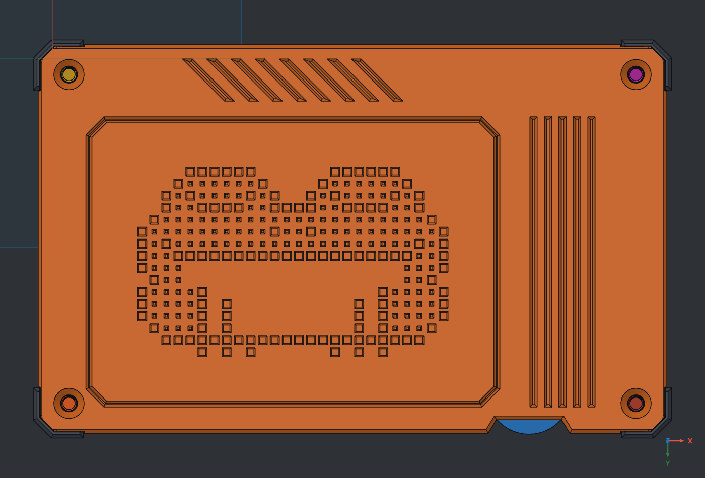
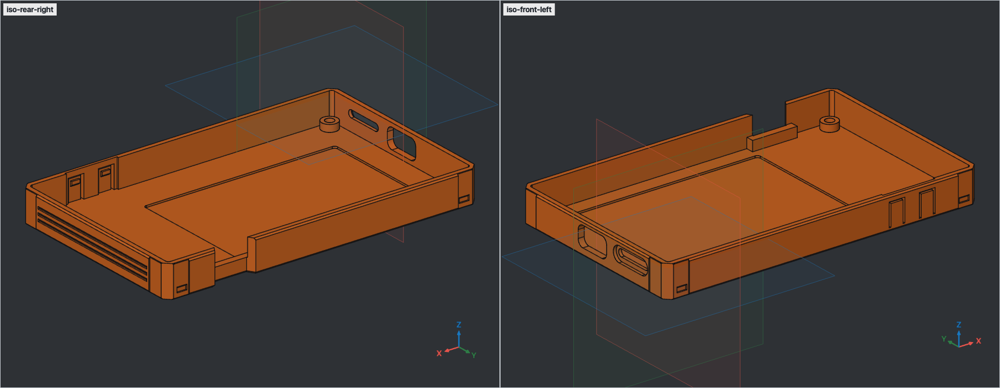
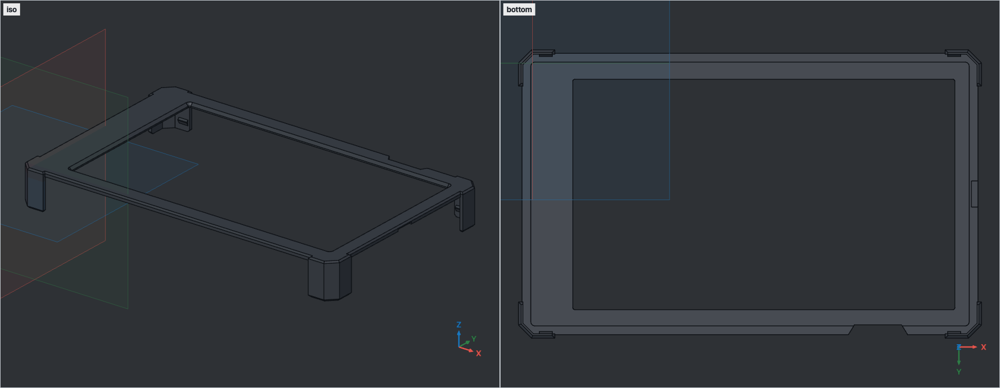
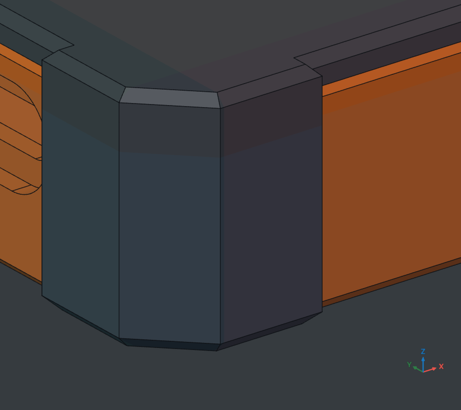
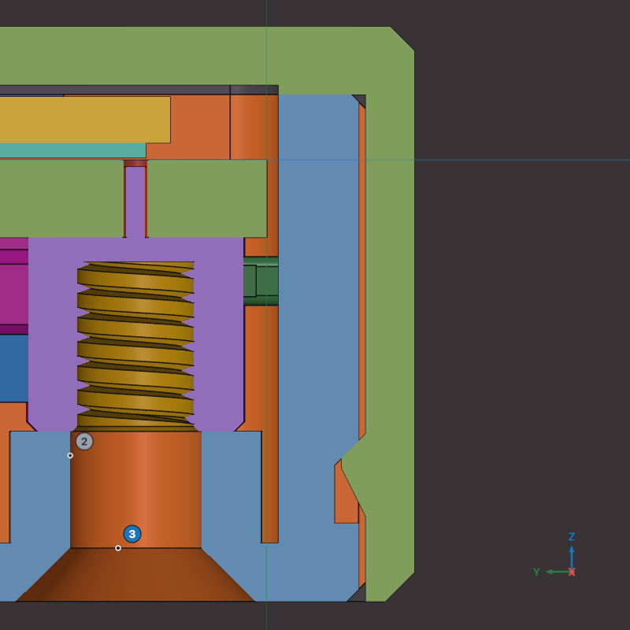
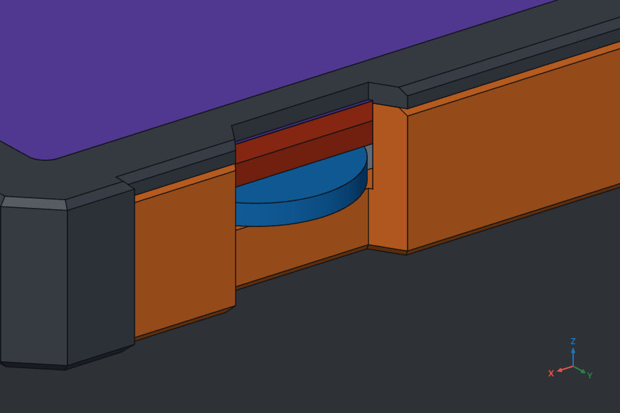

# E-reader enclosure

Enclosure for the Waveshare ESP32-S3-ePaper-3.97, modelled in ScanRuler's Reverse engineer around
Waveshare's own STEP of the board (`docs/mechanical/*.stp`, imported as reference bodies), so
every opening and clearance comes from the real part geometry. Not printed yet. Earlier designs
(v0.1, a two-part shell with a screwed-on bezel; v0.2, the tray alone with no front) are in git
history.

## v0.3: back tray + snap-on front bezel with corner caps (11.86 mm)

| File | What |
| --- | --- |
| `ereader-enclosure.scanruler` | Parametric source: 84 features, 101 parameters (4 pinned), board STEP, battery dummy, 1 open note |
| `ereader-enclosure.step` | Both parts as solids, `Back tray` and `Bezel` (read back and verified) |
| `back-tray.stl` | Tray print mesh (0.02 mm chord), the right way up to print |
| `front-bezel.stl` | Bezel print mesh (0.02 mm chord), as fitted: turn it face-down to print |
| `renders/*.png` | Assembly, the back with the frog, the tray and the bezel apart, a corner cap, the thumbwheel slot, sections through a cap hook, a button and the wheel |

**Size:** 105.9 × 66.1 mm over the corner caps (the tray alone is 104.3 × 64.5). **11.86 mm**
from the flat back to the bezel's flat front: 10.46 for the tray, 1.4 for the bezel (v0.1 was
14.85).

**Battery:** a 1500 mAh 454261 pouch, measured 62.5 long (with its protection board) and ~4.61
thick, 42 wide by its name. Centred at x 39.85, y 33.8, it spans x 8.6–71.1, y 12.8–54.8, with
0.92 mm to the USB-C socket and 0.96 to the thumbwheel. Length is the tight direction: about
64 mm fits between those two. A cell this size can't miss both the display FPC connector (2.0 mm under the PCB)
and the MX1.25 headers (3.4 mm), so it passes 0.3 mm under the connector. With a 0.6 mm skin
below, that sets the back face at z −9.11. The thickness is `bottom_z = min(standoff_z - back_t,
batt_top - batt_t - batt_skin)`, so a cell 3.7 mm thick or less saves 1.91 mm.

**Inside.** The floor is 1.2 mm (`floor_skin`), and the battery sits in a pocket 0.6 mm deeper.
Four bosses (Ø5.2) carry the standoffs up to their own height, z −5.6.

**Fit.** The PCB has 0.25 mm to the wall on both long sides (`clr_side`; these are the
left/right sides in portrait) and 0.4 at the ends (`clr_end`). The button stems stand 0.69 past
the PCB edge. A relief in the inner wall along the button zone (x 70.4–87.6, 0.84 deep) lets
them slide down past the wall as the board drops in.

**How it goes together.** The board drops in face up and four screws come through the back into
its brass standoffs, clamping it onto the bosses. The tray's walls stop level with the panel
glass. The bezel then snaps on over the glass and the walls. Its four corner caps run down over
the tray's corners to the back face, and a hook inside each one clicks into a groove in the tray.

**Front bezel.** One piece, 1.2 mm thick over the glass (`bezel_t`), standing on the tray's wall
tops. Its underside is relieved 0.2 mm inside the walls (`glass_gap`), so the glass takes no load:
0.25 mm separates the bezel from the panel, and 1.2 or more from the rest of the board. The
window is the panel's active area plus 0.5 mm a side (`aa_*`, `win_margin`): 87.4 × 52.84 with
R0.5 corners and a 0.8 mm 45° chamfer on its front edge (`win_ch`). It hides the PCB margin, the
glass edge and the panel's inactive border, so the frame is 11.6 mm wide at the USB-C end, where
that border is, and 5.3–5.9 elsewhere. The frame keeps the glass 1.4 mm off a table face-down.
Over the thumbwheel the bezel has the tray's flared notch cut through it too, so the slot is open
from the front face to the back.

**Corner caps.** The corners belong to the bezel. Each cap is the chamfered bumper shape
(`bump_l`, `bump_out`, `bump_ch`), one L-shaped wall from the bezel's front down to the back face,
with the same 0.6 mm chamfer round its foot as the back. It's 1.0 mm thick (`cap_t`): 0.8 stands
proud of the tray's sides, as the bumpers did, and 0.2 sits in a recess cut into the tray's
corners, with 0.15 clearance all round (`cap_gap`). Across the 45° corner the cap stays 1.0 mm
thick, and the tray wall behind it is still 1.1 mm at its thinnest. `bump_up` (0) is how far the
caps stand proud of the front: anything above 0 needs supports under the whole front when
printing.

**Hooks.** Inside each cap's long-side leg, toward its free end (`hook_x0`, mirrored), a 3 mm wide
hook (`hook_w`) sits 7 mm below the wall top (`hook_l`). It's 0.5 deep (`hook_d`), with a 45°
retaining face, a 0.2 flat (`hook_tip`) and a 1:2 lead-in. It clicks into a groove in the tray's
recess whose 45° roof meets the retaining face with no gap. Going on, the cap wall flexes 0.35 mm
there (`hook_d` − `cap_gap`). As a plain cantilever that's about 1.1 % strain. The corner stiffens
the wall, so it takes more force than a free tab would; only a test print will say how much. The
45° faces let a firm pull release it. To take the bezel off, put a spudger in the pry notch
(6 × 1.5 × 0.6, `pry_*`) under the middle of the antenna end and lever that end up. The two hooks
there let go first, then the other two. The knobs for a test print are `hook_d` (grip), `hook_l`
(stiffness) and `cap_gap` (fit).

**Frog.** The sleeping frog from the Sleep screen (`kFrog` in `src/apps/sleep.cpp`) is engraved
in the hatch panel on the back, as a dot matrix of 2 mm cells centred on the battery. Ink cells
are 1.5 mm squares and the 50 % dither cells 0.8 mm dots. Paper cells are left flat. It's 52 × 32
mm and 0.2 deep (`frog_d`): one first layer, over the battery, where the skin is 0.6. It reads
upright with the device turned over top-to-bottom (the button side up, as in the render above).
The cells are fixed in the sketch, so they don't follow the battery parameters. That sketch also
takes a few minutes to solve after any edit.

**Thumbwheel slot.** The wheel is clicked by pushing its rim straight in, and the rim stands
only 0.16 mm past the outer wall. So the notch runs the full height of the wall, from the glass
to the back face, and nothing is left under the wheel for a thumb to land on. It keeps the
notch's flare: 10.8 mm wide at the PCB edge line (y 60), 13.6 at the outer face. A solid block
under the wheel (`wheel_back`, reaching 2.5 mm in from the inner wall) closes the slot off from
the battery bay. Its face at y 60 is the slot's back wall, from the back face up to z −4.6,
0.4 mm under the wheel. The 0.6 mm back-edge chamfer runs round the slot too. The slot follows
the notch parameters (`wheel_*`). The cost is stiffness: that side wall is open for its full
height there, so only the back plate and the block hold it together.

1. Plug the battery into `BAT`, and tape it into the pocket in the floor.
2. Drop the board in face up, letting the wheel slide down its notch.
3. Fit 4 × M2.5 × 6 countersunk screws (DIN 965 / ISO 10642 style, head ≤ 5.0 mm) from the back.
4. Press the bezel straight down over the glass until all four corner hooks click.

**Printing the tray:** back face on the bed, no supports. Everything is laid out for that:
- The back is flat. Its decoration is inward grooves with 45° walls (`groove_draft`), so each layer steps in by at most its own height and nothing bridges. That covers the hatch outline, the hazard stripes and the vent slots.
- The end fins have flat floors and 45° ceilings.
- The thumbwheel slot runs straight down to the bed, so its walls are vertical and nothing overhangs.
- The corner recesses are vertical, and the hook grooves in them have 45° roofs.
- The frog is one layer of holes in the first layer. The second layer bridges each one (1.5 mm at most).
- The countersinks are 45° cones opening onto the bed. The 0.6 mm back-edge chamfer also hides elephant's foot.
- The PWR / BOOT flexures stand upright, rooted at the floor, so the tab never overhangs. Each tab is 4 × 6.9 × 0.8 mm (`tab_w`, `tab_top`, `tab_t`), and its nub has a 45° underside and sits 0.15 from the stem (`btn_gap`). An upright tab bends across the layer lines, so print it in **PETG**, or expect PLA to crack at the root.
- The remaining bridges: USB-C opening top (~8 mm flat), microSD slot and recess tops (≤ 10 mm), and the slot over each tab (5.2 mm). All are ordinary bridges.

**Printing the bezel:** front face on the bed, no supports. The front is flat. The window
chamfer and the 0.5 mm outer chamfer are 45°. The corner caps stand straight up 11.86 mm, their
hooks' retaining faces are 45°, and the chamfers on their feet face up. The glass relief and the
pry notch are open pockets on top. Print it in **PETG**, so the caps flex rather than crack.

**Checked in ScanRuler** (model only):
- **Clearances:** button stems to nubs and relief 0.15, PCB to walls 0.24, wheel 0.37, panel to tray 0.72 and to bezel 0.25, USB-C 1.80. The MX1.25 headers and ESP32 module are ~3 mm above the floor.
- **Battery:** sits on the pocket floor, 0.30 under the display FPC connector, 0.96 from the wheel, 0.92 from USB-C. A swelling pouch has only that 0.3 mm above it.
- **Contact:** the tray touches the board only at the four standoff ends. The bezel touches nothing on the board, and touches the tray only on the wall tops and the hook retaining faces. The caps stand 0.15 off the tray everywhere else.
- **Solids:** both valid and closed, with no slivers or voids, and the STEP round trip is exact. The steps between features the check flags are intended: the bezel's 0.2 mm glass relief, and the frog's 0.2 mm depth on the tray.

**Openings:** USB-C 12.4 × 6.6 (overmolds up to ~6.5 mm; the panel's flex cable wraps the board
edge just above it, so the wall stays closed over the top). microSD slot with a 15 mm fingernail
recess. Flared thumbwheel slot, open from the bezel's front to the back. Pry notch under the bezel.

**Decoration** (each one is a feature of its own, so any can be suppressed):
- Chamfered corner caps on the bezel (`bump_l`, `bump_out`, `bump_ch`, `cap_t`).
- Three fins on the antenna end (`fin_*`).
- On the back: a chamfered hatch outline round the battery (`hatch_*`, `line_*`), five vent slots spanning the hatch's height beside it (`vent_*`), and a band of 45° hazard stripes below it (`haz_*`). All 0.4 mm deep, and they follow the battery parameters.
- The pixel-art frog inside the hatch outline (`frog_d`).
- Chamfers: 0.5 mm on the bezel's front outer edges, 0.5 on the tray's top outer edges (a groove at the seam between the caps), 0.6 round the back (cap feet and thumbwheel slot included).

**Pinned parameters:** `batt_t` 4.61, `bump_up` 0, `bump_l` 7.5, `wall_t` 2.0.

**Open question** (pinned as a note in the project): **screws**. This assumes the standoffs are
fixed to the PCB. The panel glass covers their holes, so they must be.

**Not done yet:** speaker mount and grille, mic port, raised labels, a test print for
tolerances (`clr_side`, `clr_end`, `btn_gap`, `tab_t`, `cap_gap` and `hook_d` are the knobs).
