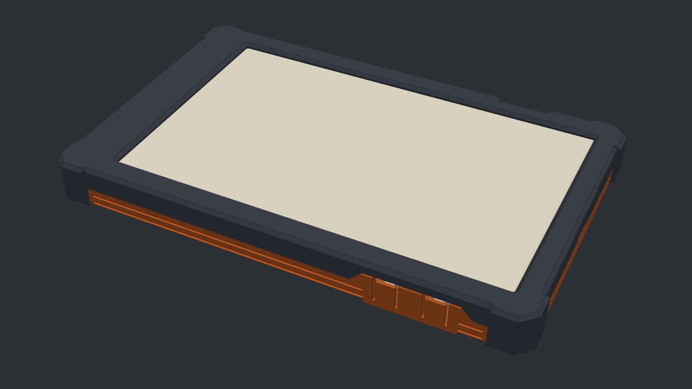
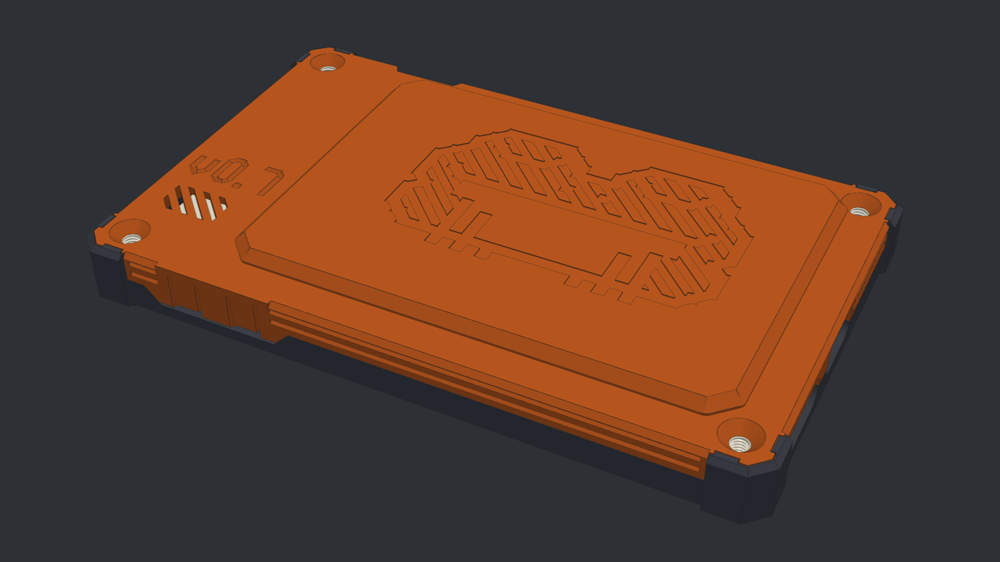
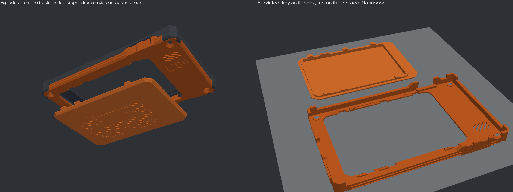

# E-reader enclosure

A 3D-printed case for the Waveshare ESP32-S3-ePaper-3.97: a back tray, a battery tub that slides
into it from the back, and a snap-on front bezel. It's 105.9 × 66.1 mm, 9.95 mm thick and 11.86 at
the battery tub, and all three parts print without supports. The revision is **v0.7**, engraved on
the tray. This revision isn't printed yet: the first print of this back (2026-11-26) held the tub
with latches that were too flimsy.

 

## To print



| Part | File | On the bed |
| --- | --- | --- |
| Back tray | `back-tray.stl` | as it loads |
| Battery tub | `battery-tub.stl` | as it loads |
| Front bezel | `front-bezel.stl` | turned over, face down |

- No supports. `tools/printcheck.py` slices them in PrusaSlicer (CORE One, 0.20 mm STRUCTURAL,
  Generic PETG) with automatic supports on and counts none.
- Print the two coupons in `coupons/` first (about 3 and 5 minutes): they're the tub's joint alone.
  [`docs/flatter-back.md`](docs/flatter-back.md) says what to try with them (**Test coupons**).
- Four M2.5 × 4 countersunk screws hold the tray to the board's standoffs.
- The STLs here are always the current design. Older ones are in git history.

## What's where

| Where | What |
| --- | --- |
| `back-tray.stl`, `battery-tub.stl`, `front-bezel.stl` | The three parts to print |
| `coupons/` | `coupon-tray.stl` and `coupon-tub.stl`: small test prints of the tub's joint |
| `model/` | What opens in ScanRuler. `ereader-enclosure.scanruler` is the base case (v0.6), the editable source, and `ereader-enclosure.step` its solids. `flatter-back.step` is the three parts as printed (v0.7). `board-one-body.step` is Waveshare's board as one body, to show beside the case; it isn't in git, and `tools/board_one_body.py` writes it |
| `tools/` | The scripts, run with `uv run` from the repo root (below) |
| `docs/` | The write-ups: [`base-case.md`](docs/base-case.md) (the ScanRuler model: hooks, bezel, openings, frog, revision) and [`flatter-back.md`](docs/flatter-back.md) (the back, the tub and its joint, the speaker). Their pictures are in `docs/img/` |
| `build/` | The tools' scratch output. Not in git |

## How the parts are made

The printed parts come from two steps:

1. The case is modelled in ScanRuler (`model/ereader-enclosure.scanruler`) and exported as solids
   (`model/ereader-enclosure.step`). That model is v0.6, with a flat back.
2. `tools/build.py` cuts the flatter back from those solids: it raises the back everywhere but
   round the battery, splits off the tub, adds its lugs and lock, the speaker grille, the bevels
   and the revision, and writes the three STLs, the coupons and `model/flatter-back.step`.

So the hooks, the bezel and the openings change in ScanRuler, and the back, the tub, the speaker
and the revision change in the constants at the top of `tools/build.py`.

```sh
uv run enclosure/tools/depthmap.py         # how deep the board reaches under the PCB (about a minute)
uv run enclosure/tools/build.py            # the STLs, the coupons, flatter-back.step, and its checks
uv run enclosure/tools/pictures.py         # docs/img/front, back, sheet, parts, sections, seam
uv run enclosure/tools/printcheck.py       # slices everything and counts supports (needs PrusaSlicer)
uv run enclosure/tools/board_one_body.py   # model/board-one-body.step (about 6 minutes)
uv run enclosure/tools/revision_glyphs.py OUT_DIR   # the engraving's font, as ScanRuler sketches
```
