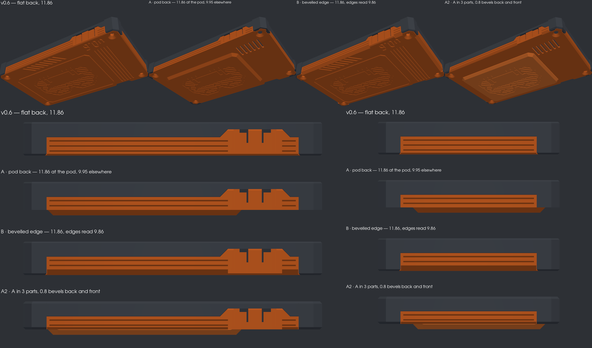
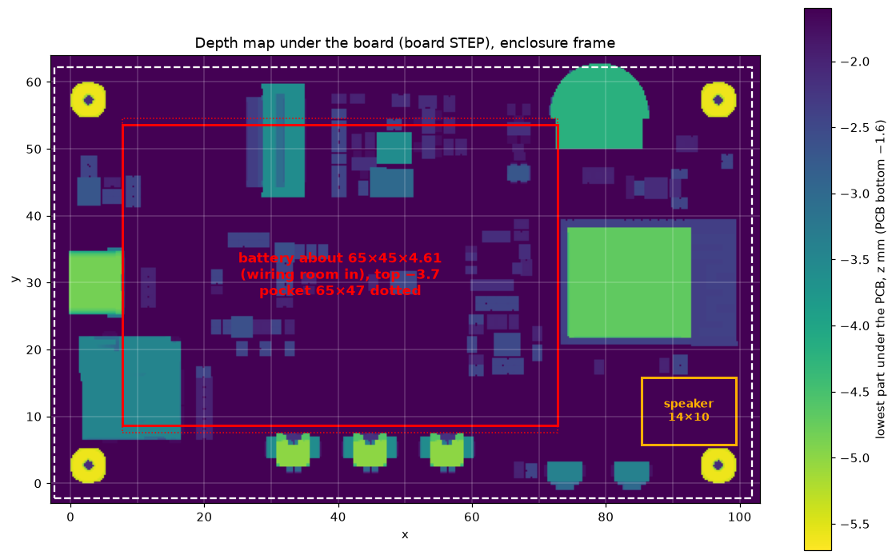
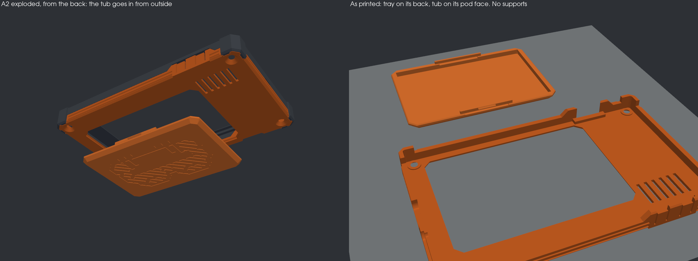
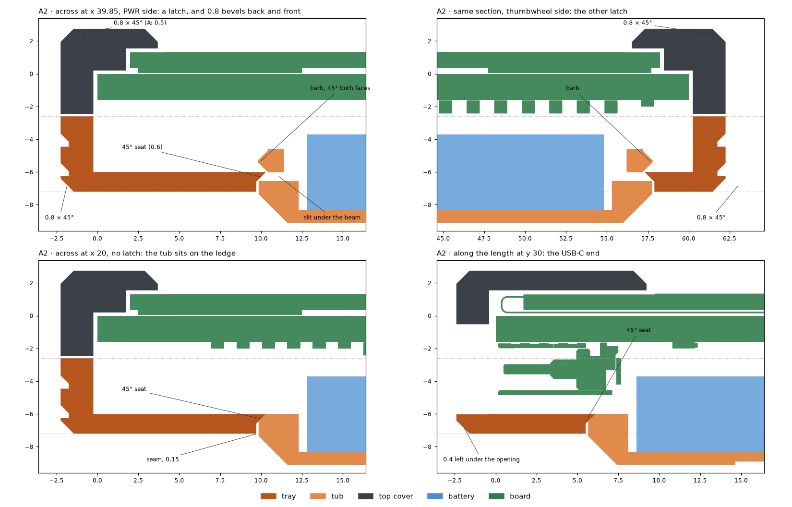

# Concept: a flatter back (not built)

There's a lot of empty space between the back of the board and the back of the tray. This asks
what the enclosure would look like if the back kept room for the battery and a speaker but was
"sucked in" everywhere else. It's a mock-up cut from the v0.6 solids in Python (cadquery), not a
change to the ScanRuler model. Nothing here is printed or fitted, and v0.6 stays as it is.



## What sets the depth



The back face of v0.6 is at z −9.11 (PCB top z 0, bezel front 2.75, 11.86 overall). It's set by the
battery: `bottom_z = min(standoff_z − back_t, batt_top − batt_t − batt_skin)`, which is
min(−5.6 − 1.6, −3.7 − 4.61 − 0.8) = −9.11. Mapping every part of Waveshare's board STEP that
hangs below the PCB shows the battery is the only thing that needs that depth. Elsewhere the
deepest thing is the screw standoffs at z −5.6. With the 1.6 mm floor the screw heads sit in, the
back could be at z −7.2: 9.95 overall, 1.91 mm thinner. The USB-C opening needs about the same.

## A · pod back

The back rises to z −7.2 everywhere except a pod round the battery. The pod's outline is the hatch
outline (`hatch_w` 68.7 × `hatch_h` 48.2, chamfer 3), with 45° flanks down to the old back face,
so the frog stays on it.


- **Look:** 11.86 at the pod, 9.95 everywhere else. The pod sits off-centre toward the USB-C end
  and the thumbwheel side, which leaves about 28 mm of thin case at the antenna end.
- **Speaker:** the field still has 3.6 to 4.0 mm under the bare PCB at the antenna end (x 74–94,
  y 4–19, between the PWR / BOOT switches and the ESP32 module). A speaker up to about 3.6 mm thick
  fits there, firing through a grille in the back, with no bump of its own. The mock-up uses a
  20 × 15 × 3.6 placeholder: Waveshare lists the kit's speaker only as "8Ω 1W", so the real one
  needs measuring. A thicker one needs its own small bump.
- **Plugs:** the MX1.25 plugs enter from +Y at z −5 to −1.6, above the new floor top (−6.0).
- **Printing:** the tray prints back-down. With the pod face on the bed, the field hangs 1.9 mm in
  the air over about 3,400 mm², so it would need supports on the visible back. A2 makes the pod its
  own part instead.
- **Knock-on changes** (none of them modelled here):
  - **Hooks:** the corner-cap hooks (z −6.4 to −8.55 in v0.6) move up about 1.9 mm. That shortens the
    cap legs and makes them two to three times as stiff, so `hook_d` would come down to about 0.4 to 0.45
    for the same strain (`hook_l` about 4.5 to 4.75).
  - **Screws:** M2.5 × 4 instead of × 6. A 6 mm screw would reach the bottom of the standoffs' blind
    threads.
  - **PWR / BOOT tabs:** 1.9 mm shorter (6.9 → 5.0), about 2.6× stiffer; maybe `tab_t` 0.6. The
    mock-up roots them in the new floor.
  - **Fins:** the lowest fin groove goes. The other two re-centre.
  - **Back decoration:** the vents, hazard stripes and revision move up onto the field. The mock-up
    drops them, and the 0.6 chamfer round the field's edges.
  - **Battery leads:** the pocket rim now rises 2.3 mm up the cell's side, so it needs a notch for
    the leads.
- **Solids:** tray 9,765 → 9,334 mm³, bezel 5,626 → 5,519 mm³ (its skirt feet trimmed to the new
  back), both valid single solids. About 0.7 g of PETG saved.

## A2 · pod back in three parts, bevelled back and front

A, with two changes: the pod is split off as a battery tub, so every part prints flat with no
supports, and a slight bevel runs round the back edge and the top cover's front edge, so it sits
softer in the hand. It's cut from `podA.step`, so A's knock-on changes still apply.



- **Why a third part:** printed back-down, A's field hangs 1.9 mm over the bed in strips 4 to 28 mm
  wide, and a 45° flank climbs only 1 mm per mm. Upside down or on an edge, the floor or a long
  wall overhangs instead. Any one part that holds both the field and the battery floor has this
  problem, and the bezel prints face-down, so it can't take either.
- **Tray:** prints field-down, flat like v0.6, with an opening on the hatch outline. At the floor's
  top, a 0.6 mm 45° ledge narrows the opening.
- **Tub:** the pod and the battery pocket. It prints on its pod face, with the frog on the bed as
  the back has it now.
- **In from outside:** the tub's 45° shoulder sits on the ledge, so a push on the back (the case
  lying on a table) goes into the tray. Fitted from inside and held by a flange, nothing but the
  battery and the board would stop that push. The seam at the field is 0.15.
- **Latches:** one on each long side, centred. Each is a beam 1.0 thick and 20 mm between its fixed
  ends, freed from the tub by a slit under it, with an 8 mm barb that overlaps the tray's floor by
  0.5. Sliced at 0.2 the slit is two empty layers, so the beam's first layer, a 20 mm bridge, goes
  down 0.4 over the rim. With one (0.2) it would sag onto the rim and fuse; with three, the
  profile, which supports bridges, puts support in the slit. The barb is 45° on both faces, because the slicer supports
  a flat catch. That makes it a soft latch: about 10 N pulls the tub out (a rough beam estimate:
  PETG at E ≈ 2 GPa, friction 0.3), against 0.3 N for the tub and cell. Going in, the beam bends
  0.5, about 1.5 % strain. Fit the tub before the battery: the beams flex into the empty pocket. The
  board leaves about 1 mm or more above them (`depthmap.py`).
- **Back bevel:** 0.8 × 45°, on the tray's walls between the corner caps and on the caps' outer
  faces (they stand 0.8 proud). The lowest fin groove starts 0.9 above the field and the USB-C
  opening 1.2 above it, so 0.8 keeps both, with 0.4 left under the opening. It skips the PWR / BOOT
  flexures, as B does. At the outer faces the case is 9.15 thick, 9.95 on the field and 11.86 at
  the pod.
- **Front bevel:** the top cover's front edge goes from A's 0.5 × 45° to 0.8, all round, caps
  included. The top cover prints face-down, so it's on the bed, like the tray's.
- **Tried instead:** the tray's sides sloping from the top cover down to the back. At 45° that
  would be 4.6 mm in at the bottom, through the 2 mm wall, so it could only be 1.5 in (72°), which
  took the fins off and opened the back edge to just 108°, against the bevel's two 135° edges.
- **Checked:** `printcheck.py` slices every part with PrusaSlicer's CORE One presets (0.20 mm
  STRUCTURAL, Generic PETG HF0.4) and automatic supports at the profile's 40°, bridges included.
  A2's tray, tub and bezel need none, and nor do v0.6's or B's. A's tray gets support on 11
  layers.
  Not checked: the tub going in (the barbs passing the ledge), tolerances on the seat, and a notch
  for the battery leads.
- **Solids:** tray 5,937 mm³, tub 3,318, bezel 5,438 (A: tray 9,334, bezel 5,519), all valid
  single solids, and the tray and tub don't overlap.



## B · bevelled edge

The back stays flat, with a 2 mm 45° bevel round its bottom edge between the corner caps. From the
side the edges look 9.86 mm thick, and the tray prints exactly as now, in one part with no supports.
The bevel skips the PWR / BOOT tabs (x 69.35 to 88.55) and fills the lowest fin groove, which it
would otherwise leave as a sliver, so the fins need re-centring. It can't go deeper at the USB-C
end without cutting into the opening. Tray 9,765 → 9,376 mm³, about 0.5 g saved.

## C · a thinner cell

The 11.86 maximum only comes down with a thinner battery. A cell 3.7 mm thick or less puts the
whole back at z −7.2: 9.95 flat, with no other change than the pinned `batt_t`. A cell that size
has roughly a quarter less capacity than the 1500 mAh one.

## Files

| File | What |
| --- | --- |
| `concepts_sheet.png` | v0.6, A, B and A2: back view, side elevation (USB-C end on the left), antenna end |
| `a2_parts.png` | A2 exploded, and its tray and tub as they print |
| `a2_seam.png` | Close-ups of A2's seat, latches and bevels |
| `sections.png` | Sections through v0.6 and A at y 15 (battery and speaker spot) and x 44.8 (an MX1.25 header) |
| `depthmap.png` | The lowest part under the PCB, everywhere, with the battery outline |
| `podA.step` | Concept A, tray and bezel as solids |
| `podA_tray.stl`, `podA_bezel.stl` | Concept A meshes (0.02 mm chord), as fitted |
| `bevelB_tray.stl` | Concept B tray mesh; it uses the v0.6 bezel |
| `a2.step` | Concept A2: tray, tub and bezel as solids |
| `a2_tray.stl`, `a2_tub.stl`, `a2_bezel.stl` | Concept A2 meshes (0.02 mm chord), as fitted |
| `depthmap.py` | Board STEP → `depthmap.png`, and `build/board.stl` for the sections |
| `build_pod.py`, `build_bevel.py` | v0.6 STEP → concepts A and B (constants at the top) |
| `build_a2.py` | `podA.step` → concept A2 |
| `render.py`, `sections.py` | The sheet and A2's parts; the sections and A2's close-ups |
| `printcheck.py` | Slices every part in PrusaSlicer with automatic supports and counts them |

To rebuild, from the repo root (`build/` holds the intermediates and isn't committed):

```sh
uv run enclosure/concepts/flatter-back/depthmap.py      # about a minute
uv run enclosure/concepts/flatter-back/build_pod.py
uv run enclosure/concepts/flatter-back/build_bevel.py
uv run enclosure/concepts/flatter-back/build_a2.py      # after build_pod.py: it starts from podA.step
uv run enclosure/concepts/flatter-back/render.py
uv run enclosure/concepts/flatter-back/sections.py
uv run enclosure/concepts/flatter-back/printcheck.py    # needs PrusaSlicer, at its macOS path
```

Sources for the speaker: [Waveshare ESP32-S3-ePaper-3.97 (SKU 33810)](https://www.waveshare.com/esp32-s3-epaper-3.97.htm?sku=33810),
[Hubtronics listing](https://hubtronics.in/esp32-s3-epaper-3.97).
