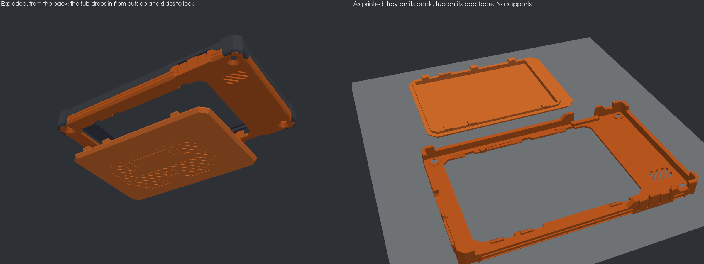

# Concept: a flatter back

There's a lot of empty space between the back of the board and the back of the tray. This asks
what the enclosure would look like if the back kept room for the battery and a speaker but was
"sucked in" everywhere else, and still printed without supports. It's a mock-up cut from the v0.6
solids in Python (cadquery), not a change to the ScanRuler model. Its three print meshes are the
STLs at the root of `enclosure/`, where they replaced v0.6's (2026-11-26). The ScanRuler model and
`ereader-enclosure.step` stay v0.6.

**Printed once** (2026-11-26), with the tub held by flexing latches: they were too flimsy, and the
tub popped out the back. Fitting it from the back was easy. This version keeps that and holds the
tub with solid lugs instead (see **Lugs**); it isn't printed yet. Print the two coupons first
(see **Test coupons**).


## What sets the depth


The back face of v0.6 is at z −9.11 (PCB top z 0, bezel front 2.75, 11.86 overall). It's set by the
battery: `bottom_z = min(standoff_z − back_t, batt_top − batt_t − batt_skin)`, which is
min(−5.6 − 1.6, −3.7 − 4.61 − 0.8) = −9.11. Mapping every part of Waveshare's board STEP that
hangs below the PCB shows the battery is the only thing that needs that depth. Elsewhere the
deepest thing is the screw standoffs at z −5.6. With the 1.6 mm floor the screw heads sit in, the
back could be at z −7.2: 9.95 overall, 1.91 mm thinner. The USB-C opening needs about the same.

## The design

The back rises to z −7.2 everywhere except round the battery, where a tub keeps v0.6's depth. The
tub is a part of its own, so the case is three: back tray, battery tub and front bezel. On the back
the tub is a pod 77.6 × 54.6 at the field (74.6 × 51.6 at its face), with a 0.4 edge and then 45°
flanks down to the old back face, so the frog stays on it. That's the battery pocket with 3.8 round
it, and 5 more at the antenna end, which the tub slides. The hatch line v0.6 engraves, inside the
pod now, is filled.



- **Look:** 11.86 at the tub, 9.95 everywhere else. The tub sits off-centre toward the USB-C end and
  the thumbwheel side, which leaves about 20 mm of thin case at the antenna end.
- **Why three parts:** printed back-down in one piece, the field hangs 1.9 mm over the bed in strips
  4 to 20 mm wide, and a 45° flank climbs only 1 mm per mm. Upside down or on an edge, the floor or
  a long wall overhangs instead. Any one part that holds both the field and the battery floor has
  this problem, and the bezel prints face-down, so it can't take either.
- **Tray:** prints field-down, flat like v0.6, with an opening 74.0 × 51.0 for the tub. The
  opening's bed edge has a 0.3 chamfer, clear of elephant's foot.
- **Tub:** prints on its face, with the frog on the bed as the back has it now.
- **In from the back:** the tub's rim laps 1.8 onto the field all round the opening, flat on flat.
  So a push on the back (the case lying on a table) goes into the tray, not into the battery and
  board. Its wall, 1.85 thick, comes up through the opening with 0.15 a side.
- **Lugs:** six, solid, on the tub's long walls above the tray's floor: three a side, each 4 long.
  Nothing has to bend to hold the tub in.
  - *Going in:* the tub drops in from the back 5 mm toward the antenna end, where each lug comes up
    through a notch in the floor's edge. Then it slides 5 mm toward the USB end, and each lug ends
    up over a seat.
  - *The seat* is a rail on the floor beside the opening. Its face slopes at 45° from the opening's
    edge, 1.2 up and out. The lug's underside is the same slope, 0.1 over it, so the lug prints as a
    45° overhang and overlaps the seat by 1.15 (the latches before it had 0.4). The seat falls 0.3
    over its last 1.2, toward the notch, to lead the lug on.
  - *Where:* PWR side at x 12, 24 and 63; thumbwheel side at 12, 40 and 63 (each lug's USB-end end,
    locked). The board leaves 1.15 over the first (under the SD socket) and 2.1 or more over the
    rest. Under the MX1.25 headers (PWR side, x 30 to 60) there's only 1.0 over the floor, so none
    go there.
  - *Covered:* the notches reach 1.45 out from the opening and the rim 1.8, so nothing shows.
- **Lock:** a finger cut from the floor's edge on the thumbwheel side (x 24 to 38.5, 1.2 wide,
  fixed at its antenna end), with a tooth on its tip. It prints flat on the bed, and its slit is
  under the tub's rim.
  - *Going in*, the tub's wall pushes the tooth aside by its 45° underside (0.85, about 0.7 % strain),
    and it rides the wall as the tub slides. When the tub is home it springs into a notch in the
    wall.
  - *Locked*, the tub can't slide back: it pushes on the tooth endways, along the finger, which is
    a strut then and doesn't bend. Both faces are square. There's 0.15 of play.
  - *Coming out:* from inside, push the finger's tip away from the tub and slide the tub 5 mm toward
    the antenna end.
  - It only stops the tub sliding. The lugs' slopes face across the tub, so a pull on the tub
    doesn't push it along.
- **The antenna end:** locked, the tub's wall stands 5.15 short of the opening's end. That gap is
  open inside and covered outside by the pod.
- **Bevels:** 0.8 × 45° round the back edge, on the tray's walls between the corner caps and on the
  caps' outer faces (they stand 0.8 proud), and on the front bezel's front edge (0.5 in v0.6), so it
  sits softer in the hand. Each is on the bed side of its part. The lowest fin groove starts 0.9
  above the field and the USB-C opening 1.2 above it, so 0.8 keeps both, with 0.4 left under the
  opening. The back bevel skips the PWR / BOOT flexures. At the outer faces the case is 9.15 thick.
- **Speaker:** 14 × 10 mm, long side along the case, between the antenna end's corner screw and the
  ESP32 module (x 85.4 to 99.4, y 7.8 to 17.8; it's on the depth map). That's 2 mm nearer the
  ESP32 than in the first print, and the grille moved with it. Nothing hangs below the board as far
  as y 16.6, and small parts hang to z −2.4 over its last 1.2 mm, so it has 3.6 mm of height over
  the floor there, 3.3 with 0.3 clear: the floor top is z −6.0. The ESP32's shield starts about
  y 22. The screw's boss on the floor reaches y 5.3. It fires through a grille in the back, with no
  bump of its own: 0.8 mm slots at 45°, parallel to the frog's hatch, on a 2 mm pitch over a 10 × 6
  patch under its middle (x 87.4 to 97.4, y 9.8 to 15.8), about 24 mm² open. Its thickness isn't
  given; the mock-up draws 3.0.
- **Plugs:** the MX1.25 plugs enter from +Y at z −5 to −1.6, above the new floor top (−6.0). The
  tub's wall passes under the headers with 1.0 to spare.
- **Checked:**
  - `build.py` moves the tub along its way in (up through the notches at three heights, then along
    the slide at four) and finds no overlap with the tray anywhere, the tooth aside, and none locked.
  - It also measures the room under the board over every lug and the lock, from the depth map: 1.15
    at the least.
  - `printcheck.py` slices every part and both coupons with PrusaSlicer's CORE One presets (0.20 mm
    STRUCTURAL, Generic PETG HF0.4) and automatic supports at the profile's 40°, bridges included:
    none needs any. The tray has no bridges at all.
  - Not checked: the fit (the 0.1 over the seats, the 0.15 round the wall, the lock's 0.15), how
    much pull the lugs take (no estimate this time: the coupon is the test), the finger's spring,
    and a notch for the battery leads.
- **Solids:** tray 5,368 mm³, tub 4,802, bezel 5,438 (v0.6: tray 9,765, bezel 5,626), all valid
  single solids. About 0.3 g of PETG more than v0.6: the pod's rim and the lugs.


## Battery and tub

| | |
| --- | --- |
| Cell | 1500 mAh 454261 pouch, about 65 long and 45 wide with room for the wiring out of its side, about 4.5 thick |
| Pocket | 65.0 × 47.0 (x 7.8 to 72.8, y 7.6 to 54.6), floor at z −8.31: all the room the board leaves at the cell's height |
| In the pocket | none to spare along it, 1.0 a side across |
| Ends | 0.12 to the USB-C socket's shell, and the thumbwheel's body at the other end (x 72.8, for y over 50.4) |
| Height | no more than v0.5 gives: 4.61 (`batt_t`) from the pocket floor to z −3.7, so 0.11 over a 4.5 cell |
| Under the cell | 0.8 of skin, the tub's face at z −9.11. The frog takes 0.2 of it, so 0.6 is under the frog |
| Over the cell | 0.10 over the room to the display FPC connector (z −3.60), as in v0.6: 0.21 over a 4.5 cell, which also passes 0.19 under the tips of the USB-C socket's pins at its very end |
| Pocket walls | 2.31 up the cell's sides (to the floor top, z −6.0), 1.85 thick through the opening, 3.8 with the rim below the field |
| Lugs | 3.71 up the cell's sides (to z −4.6) where the lugs are, 3.51 at the lock |
| Tub, outside | 77.6 × 54.6 at the field, 74.6 × 51.6 at its face, 3.11 tall (4.51 at the lugs) |

The length is at the limit. At that height the cell can't pass under the USB-C socket or the
thumbwheel, and the board leaves 65.0 between them wherever a cell 45 wide sits; a longer one
doesn't fit at this height at all. If it's 62.5, as the enclosure README has it measured with its
protection board, there's 2.5 to spare. Either way it's more than v0.6's pocket (63.5 × 43) takes,
so measure the cell's length, and which side its wiring leaves, before a print.

## Not modelled yet

- **Hooks:** the corner-cap hooks (z −6.4 to −8.55 in v0.6) move up about 1.9 mm. That shortens the
  cap legs and makes them two to three times as stiff, so `hook_d` would come down to about 0.4 to
  0.45 for the same strain (`hook_l` about 4.5 to 4.75).
- **Screws:** M2.5 × 4 instead of × 6. A 6 mm screw would reach the bottom of the standoffs' blind
  threads.
- **PWR / BOOT tabs:** 1.9 mm shorter (6.9 → 5.0), about 2.6× stiffer; maybe `tab_t` 0.6. The
  mock-up roots them in the new floor.
- **Fins:** the lowest fin groove goes. The other two re-centre.
- **Back decoration:** the vents, hazard stripes and revision move up onto the field. The mock-up
  drops them, and the 0.6 chamfer round the field's edges.
- **Battery leads:** the pocket's walls rise 2.3 mm up the cell's sides, so they need a notch for
  the leads.

## Test coupons

`coupon-tray.stl` and `coupon-tub.stl` are the joint alone, to print before the whole parts: the
USB-end 32 mm of the tub and the floor beside it, with the middle taken out and the two sides closed
up (46 × 23 and 32 × 18 mm). They carry three lugs with their seats and notches, and the lock. Print
both as they are, no supports; PrusaSlicer puts them at about 3 and 5 minutes.

- The tub coupon only goes into the frame from the back where its lugs meet the notches. Slide it
  5 mm toward the end where the frame's finger has its tip, until the finger clicks.
- Then pull it out the back, and push it back along the slide. Neither should move it.
- To free it, push the finger's tip away from the tub, from inside, and slide it back.
- If it won't slide, or rattles, the play over the seats (`LUG["play"]`, 0.1) is the knob. If it
  won't drop in, `GAP` and `NOTCH`.

## Tried, and left out

These are in this folder's git history.

- **Tongue-in-window latches** (the second version, printed 2026-11-26): three beams cut from the
  tub's wall, each with a window that a tongue on the tray reached into. The tongue went 0.4 into
  the window with 0.15 of play, less than one extrusion width, and the beams had to flex to let the
  tub in. A rough estimate said 68 N for the three; printed, the tub popped out the back.
- **Barbed latches** (the first version): two 1.0 × 1.4 beams sitting on the wall's top, each with
  a 45° barb over the tray's floor. A pull pushed the beam in, so the pair let go at about 11 N, a
  jolt of about 35 g. At that pull the beams were at about PETG's yield, and their ends, held on by
  2 × 1 mm patches of a single layer bond, were under about 20 MPa of peel.
- **One piece:** the same back with the tub part of the tray. PrusaSlicer supports the field, on
  the visible back, over 11 layers.
- **A bevel alone:** the back stays flat, with a 2 mm 45° bevel round its edge. One part, no
  supports, and the edges read 9.86, but the case is 11.86 everywhere else.
- **A thinner cell:** one 3.7 mm thick or less puts the whole back at z −7.2, 9.95 flat, with
  `batt_t` the only change, at roughly a quarter less capacity.
- **Sides sloping to the front bezel** instead of the back bevel: at 45° that's 4.6 mm in at the
  bottom, through the 2 mm wall, so it could only be 1.5 in (72°). That took the fins off and
  opened the back edge to just 108°, against the bevel's two 135° edges.

## Files

| File | What |
| --- | --- |
| `../../back-tray.stl`, `../../battery-tub.stl`, `../../front-bezel.stl` | The three parts (0.02 mm chord), as fitted: the tray and tub print on their backs, the bezel face-down. `build.py` writes them at the root of `enclosure/` |
| `flatter-back.step` | The three as solids |
| `coupon-tray.stl`, `coupon-tub.stl` | The joint alone, to print first (**Test coupons**) |
| `sheet.png` | v0.6 and the flatter back: back view, side (USB-C end on the left), antenna end |
| `parts.png` | Exploded, and as printed |
| `sections.png` | v0.6 and the flatter back along y 13.5 and across x 44.8, with the board, battery and speaker |
| `seam.png` | Close-ups of the lugs, their notches, the lock and the bevels |
| `depthmap.png` | The lowest part under the PCB, everywhere, with the battery and speaker |
| `build.py` | v0.6 STEP → the parts and the coupons (constants at the top); checks the tub's way in and the room under the board |
| `depthmap.py` | Board STEP → `depthmap.png`, and `build/board.stl` for the pictures |
| `pictures.py` | The pictures |
| `printcheck.py` | Slices the parts and the coupons in PrusaSlicer with automatic supports and counts them |

To rebuild, from the repo root (`build/` holds the intermediates and isn't committed):

```sh
uv run enclosure/concepts/flatter-back/depthmap.py      # about a minute
uv run enclosure/concepts/flatter-back/build.py
uv run enclosure/concepts/flatter-back/pictures.py
uv run enclosure/concepts/flatter-back/printcheck.py    # needs PrusaSlicer, at its macOS path
```
