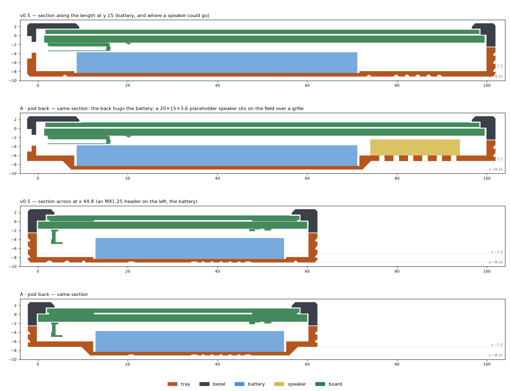

# Concept: a flatter back (not built)

There's a lot of empty space between the back of the board and the back of the tray. This asks
what the enclosure would look like if the back kept room for the battery and a speaker but was
"sucked in" everywhere else. It's a mock-up cut from the v0.5 solids in Python (cadquery), not a
change to the ScanRuler model. Nothing here is printed or fitted, and v0.5 stays as it is.


## What sets the depth


The back face of v0.5 is at z −9.11 (PCB top z 0, bezel front 2.75, 11.86 overall). It's set by the
battery: `bottom_z = min(standoff_z − back_t, batt_top − batt_t − batt_skin)`, which is
min(−5.6 − 1.6, −3.7 − 4.61 − 0.8) = −9.11. Mapping every part of Waveshare's board STEP that
hangs below the PCB shows the battery is the only thing that needs that depth. Elsewhere the
deepest thing is the screw standoffs at z −5.6. With the 1.6 mm floor the screw heads sit in, the
back could be at z −7.2: 9.95 overall, 1.91 mm thinner. The USB-C opening needs about the same.

## A · pod back

The back rises to z −7.2 everywhere except a pod round the battery. The pod's outline is the hatch
outline (`hatch_w` 68.7 × `hatch_h` 48.2, chamfer 3), with 45° flanks down to the old back face,
so the frog stays on it.



- **Look:** 11.86 at the pod, 9.95 everywhere else. The pod sits off-centre toward the USB-C end
  and the thumbwheel side, which leaves about 28 mm of thin case at the antenna end.
- **Speaker:** the field still has 3.6 to 4.0 mm under the bare PCB at the antenna end (x 74–94,
  y 4–19, between the PWR / BOOT switches and the ESP32 module). A speaker up to about 3.6 mm thick
  fits there, firing through a grille in the back, with no bump of its own. The mock-up uses a
  20 × 15 × 3.6 placeholder: Waveshare lists the kit's speaker only as "8Ω 1W", so the real one
  needs measuring. A thicker one needs its own small bump.
- **Plugs:** the MX1.25 plugs enter from +Y at z −5 to −1.6, above the new floor top (−6.0).
- **Printing:** the tray prints back-down. With the pod face on the bed, the field hangs 1.9 mm in
  the air over about 3,400 mm², so it would need supports on the visible back. The clean fix is to
  make the pod its own part: a battery tub that drops into an opening in the tray from inside, held
  by its flange. Both parts then print flat, and the hatch outline becomes a real seam.
- **Knock-on changes** (none of them modelled here):
  - **Hooks:** the corner-cap hooks (z −6.2 to −8.35 now) move up about 1.9 mm. That shortens the
    cap legs and makes them two to three times as stiff, so `hook_d` would come down to about 0.4 to 0.45
    for the same strain (`hook_l` about 4.5 to 4.75).
  - **Screws:** M2.5 × 4 instead of × 6. A 6 mm screw would reach the bottom of the standoffs' blind
    threads.
  - **PWR / BOOT tabs:** 1.9 mm shorter (6.9 → 5.0), about 2.6× stiffer; maybe `tab_t` 0.6. The
    mock-up roots them in the new floor.
  - **Fins:** the lowest fin groove goes. The other two re-centre.
  - **Back decoration:** the vents, hazard stripes and revision move up onto the field. The mock-up
    drops them, and the 0.6 chamfer round the field's edges.
  - **Battery leads:** the pocket rim now rises 2.3 mm up the cell's side, so it needs a notch for
    the leads.
- **Solids:** tray 9,876 → 9,444 mm³, bezel 5,626 → 5,522 mm³ (its skirt feet trimmed to the new
  back), both valid single solids. About 0.7 g of PETG saved.

## B · bevelled edge

The back stays flat, with a 2 mm 45° bevel round its bottom edge between the corner caps. From the
side the edges look 9.86 mm thick, and the tray prints exactly as now, in one part with no supports.
The bevel skips the PWR / BOOT tabs (x 69.35 to 88.55) and fills the lowest fin groove, which it
would otherwise leave as a sliver, so the fins need re-centring. It can't go deeper at the USB-C
end without cutting into the opening. Tray 9,876 → 9,487 mm³, about 0.5 g saved.

## C · a thinner cell

The 11.86 maximum only comes down with a thinner battery. A cell 3.7 mm thick or less puts the
whole back at z −7.2: 9.95 flat, with no other change than the pinned `batt_t`. A cell that size
has roughly a quarter less capacity than the 1500 mAh one.

## Files

| File | What |
| --- | --- |
| `concepts_sheet.png` | v0.5, A and B: back view, side elevation (USB-C end on the left), antenna end |
| `sections.png` | Sections through v0.5 and A at y 15 (battery and speaker spot) and x 44.8 (an MX1.25 header) |
| `depthmap.png` | The lowest part under the PCB, everywhere, with the battery outline |
| `podA.step` | Concept A, tray and bezel as solids |
| `podA_tray.stl`, `podA_bezel.stl` | Concept A meshes (0.02 mm chord), as fitted |
| `bevelB_tray.stl` | Concept B tray mesh; it uses the v0.5 bezel |
| `depthmap.py` | Board STEP → `depthmap.png`, and `build/board.stl` for the sections |
| `build_pod.py`, `build_bevel.py` | v0.5 STEP → concepts A and B (constants at the top) |
| `render.py`, `sections.py` | The sheet and the sections |

To rebuild, from the repo root (`build/` holds the intermediates and isn't committed):

```sh
uv run enclosure/concepts/flatter-back/depthmap.py      # about a minute
uv run enclosure/concepts/flatter-back/build_pod.py
uv run enclosure/concepts/flatter-back/build_bevel.py
uv run enclosure/concepts/flatter-back/render.py
uv run enclosure/concepts/flatter-back/sections.py
```

Sources for the speaker: [Waveshare ESP32-S3-ePaper-3.97 (SKU 33810)](https://www.waveshare.com/esp32-s3-epaper-3.97.htm?sku=33810),
[Hubtronics listing](https://hubtronics.in/esp32-s3-epaper-3.97).
