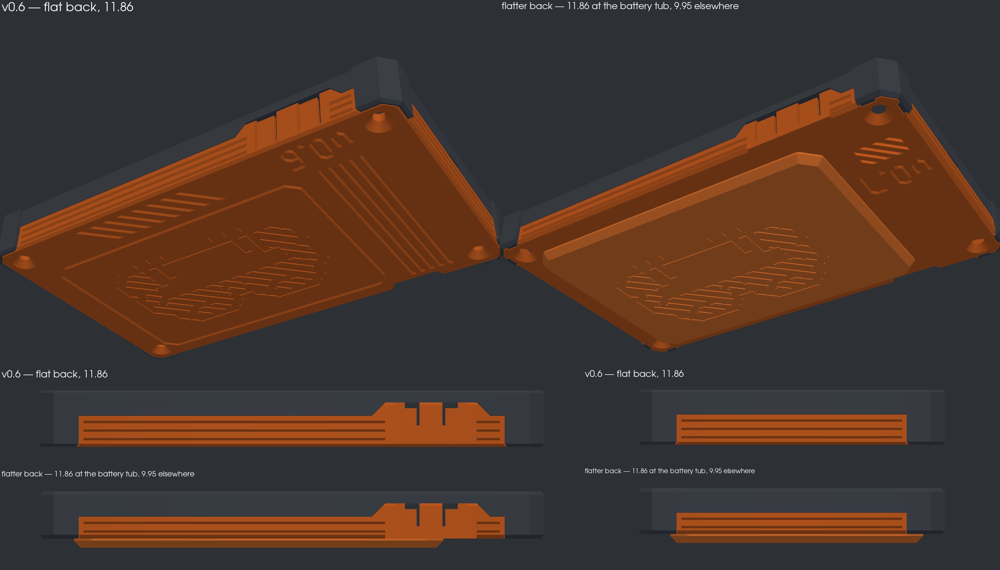

# Concept: a flatter back (not built)

There's a lot of empty space between the back of the board and the back of the tray. This asks
what the enclosure would look like if the back kept room for the battery and a speaker but was
"sucked in" everywhere else, and still printed without supports. It's a mock-up cut from the v0.6
solids in Python (cadquery), not a change to the ScanRuler model. Nothing here is printed or
fitted, and v0.6 stays as it is.



## What sets the depth


The back face of v0.6 is at z −9.11 (PCB top z 0, bezel front 2.75, 11.86 overall). It's set by the
battery: `bottom_z = min(standoff_z − back_t, batt_top − batt_t − batt_skin)`, which is
min(−5.6 − 1.6, −3.7 − 4.61 − 0.8) = −9.11. Mapping every part of Waveshare's board STEP that
hangs below the PCB shows the battery is the only thing that needs that depth. Elsewhere the
deepest thing is the screw standoffs at z −5.6. With the 1.6 mm floor the screw heads sit in, the
back could be at z −7.2: 9.95 overall, 1.91 mm thinner. The USB-C opening needs about the same.

## The design

The back rises to z −7.2 everywhere except round the battery, where a tub keeps v0.6's depth. The
tub's outline is the battery pocket with 2.6 round it (70.2 × 52.2, chamfer 3, a little bigger than
v0.6's hatch outline, 68.7 × 48.2), with 45° flanks down to the old back face, so the frog stays on
it. The hatch line v0.6 engraves, inside it now, is filled. The tub is a part of its own, so the
case is three: back tray, battery tub and front bezel.


- **Look:** 11.86 at the tub, 9.95 everywhere else. The tub sits off-centre toward the USB-C end and
  the thumbwheel side, which leaves about 26 mm of thin case at the antenna end.
- **Why three parts:** printed back-down in one piece, the field hangs 1.9 mm over the bed in strips
  5 to 27 mm wide, and a 45° flank climbs only 1 mm per mm. Upside down or on an edge, the floor or
  a long wall overhangs instead. Any one part that holds both the field and the battery floor has
  this problem, and the bezel prints face-down, so it can't take either.
- **Tray:** prints field-down, flat like v0.6, with an opening on the hatch outline. At the floor's
  top, a 0.6 mm 45° ledge narrows the opening.
- **Tub:** prints on its face, with the frog on the bed as the back has it now.
- **In from outside:** the tub's 45° shoulder sits on the ledge, so a push on the back (the case
  lying on a table) goes into the tray. Fitted from inside and held by a flange, nothing but the
  battery and the board would stop that push. The seam at the field is 0.15.
- **Latches:** one on each long side. Each is a beam 1.0 thick, freed from the tub by a slit under
  it, with an 8 mm barb that overlaps the tray's floor by 0.5. The thumbwheel side's is centred and
  20 mm between its fixed ends; the PWR side's sits at x 8.6 to 30.6, clear of the MX1.25 headers,
  and is 18. Sliced at 0.2 the slit is two empty layers, so the beam's first layer, a 20 mm bridge, goes
  down 0.4 over the rim. With one (0.2) it would sag onto the rim and fuse; with three, the
  profile, which supports bridges, puts support in the slit. The barb is 45° on both faces,
  because the slicer supports a flat catch. That makes it a soft latch: about 12 N pulls the tub
  out (a rough beam estimate: PETG at E ≈ 2 GPa, friction 0.3), against 0.3 N for the tub and
  cell. Going in, the beams bend 0.5, about 1.5 % strain (1.9 % for the shorter one). Fit the tub before the battery: the beams
  flex into the empty pocket. The board leaves about 1 mm or more above them.
- **Bevels:** 0.8 × 45° round the back edge, on the tray's walls between the corner caps and on the
  caps' outer faces (they stand 0.8 proud), and on the front bezel's front edge (0.5 in v0.6), so it
  sits softer in the hand. Each is on the bed side of its part. The lowest fin groove starts 0.9
  above the field and the USB-C opening 1.2 above it, so 0.8 keeps both, with 0.4 left under the
  opening. The back bevel skips the PWR / BOOT flexures. At the outer faces the case is 9.15 thick.
- **Speaker:** 14 × 10 mm, long side along the case, between the antenna end's corner screw and the
  ESP32 module (x 85.4 to 99.4, y 5.8 to 15.8; it's on the depth map). Nothing hangs below the
  board there, so it has 4.1 mm of height over the floor, 0.3 clear of the PCB: the floor top is
  z −6.0, the PCB's underside −1.6. Turned the other way (10 along the case, 14 across), it fits
  over the screw only up to 3.2 thick, because parts at y 16.6 to 19 hang to z −2.4. The screw's
  boss on the floor reaches y 5.3. It fires through a grille in the back, with no bump of its own:
  0.8 mm slots at 45°, parallel to the frog's hatch, on a 2 mm pitch over a 10 × 6 patch under its
  middle, about 24 mm² open. Its thickness isn't given; the mock-up draws 3.0.
- **Plugs:** the MX1.25 plugs enter from +Y at z −5 to −1.6, above the new floor top (−6.0). The
  tub's rim passes under the headers with 1.0 to spare.
- **Checked:** `printcheck.py` slices every part with PrusaSlicer's CORE One presets (0.20 mm
  STRUCTURAL, Generic PETG HF0.4) and automatic supports at the profile's 40°, bridges included:
  none of the three needs any, nor do v0.6's two. Not checked: the tub going in (the barbs passing
  the ledge), tolerances on the seat, and a notch for the battery leads.
- **Solids:** tray 5,574 mm³, tub 3,643, bezel 5,438 (v0.6: tray 9,765, bezel 5,626), all valid
  single solids, and the tray and tub don't overlap. About 0.9 g of PETG saved.


## Battery and tub

| | |
| --- | --- |
| Cell | 1500 mAh 454261 pouch, about 65 long and 45 wide with room for the wiring out of its side, about 4.5 thick |
| Pocket | 65.0 × 47.0 (x 7.8 to 72.8, y 7.6 to 54.6), floor at z −8.31: all the room the board leaves at the cell's height |
| In the pocket | none to spare along it, 1.0 a side across |
| Ends | 0.12 to the USB-C socket's shell, and the thumbwheel's body at the other end (x 72.8, for y over 50.4) |
| Height | no more than v0.5 gives: 4.61 (`batt_t`) from the pocket floor to z −3.7, so 0.11 over a 4.5 cell |
| Under the cell | 0.8 of skin, the tub's face at z −9.11. The frog takes 0.2 of it, so 0.6 is under the frog |
| Over the cell | 0.10 over the room to the display FPC connector (z −3.60), as in v0.6: 0.21 over a 4.5 cell, which also passes 0.19 under the tips of the USB-C socket's pins at its very end |
| Pocket walls | 2.31 up the cell's sides (to the floor top, z −6.0), 2.45 thick at the seam |
| Latch beams | 1.9 from the cell's long sides. They flex 0.5 toward it going in, before the battery is |
| Tub, outside | 69.9 × 51.9 at the seam, 66.4 × 48.4 at its face, 3.11 tall (4.51 at the latches) |

The length is at the limit. At that height the cell can't pass under the USB-C socket or the
thumbwheel, and the board leaves 65.0 between them wherever a cell 45 wide sits; a longer one
doesn't fit at this height at all. If it's 62.5, as the enclosure README has it measured with its
protection board, there's 2.5 to spare. Either way it's more than v0.6's pocket (63.5 × 43) takes,
so measure the cell's length, and which side its wiring leaves, before a print.

## Not modelled yet

- **Hooks:** the corner-cap hooks (z −6.4 to −8.55 in v0.6) move up about 1.9 mm. That shortens the
  cap legs and makes them two to three times as stiff, so `hook_d` would come down to about 0.4 to
  0.45 for the same strain (`hook_l` about 4.5 to 4.75).
- **Screws:** M2.5 × 4 instead of × 6. A 6 mm screw would reach the bottom of the standoffs' blind
  threads.
- **PWR / BOOT tabs:** 1.9 mm shorter (6.9 → 5.0), about 2.6× stiffer; maybe `tab_t` 0.6. The
  mock-up roots them in the new floor.
- **Fins:** the lowest fin groove goes. The other two re-centre.
- **Back decoration:** the vents, hazard stripes and revision move up onto the field. The mock-up
  drops them, and the 0.6 chamfer round the field's edges.
- **Battery leads:** the pocket's walls rise 2.3 mm up the cell's sides, so they need a notch for
  the leads.

## Tried, and left out

These are in this folder's git history.

- **One piece:** the same back with the tub part of the tray. PrusaSlicer supports the field, on
  the visible back, over 11 layers.
- **A bevel alone:** the back stays flat, with a 2 mm 45° bevel round its edge. One part, no
  supports, and the edges read 9.86, but the case is 11.86 everywhere else.
- **A thinner cell:** one 3.7 mm thick or less puts the whole back at z −7.2, 9.95 flat, with
  `batt_t` the only change, at roughly a quarter less capacity.
- **Sides sloping to the front bezel** instead of the back bevel: at 45° that's 4.6 mm in at the
  bottom, through the 2 mm wall, so it could only be 1.5 in (72°). That took the fins off and
  opened the back edge to just 108°, against the bevel's two 135° edges.

## Files

| File | What |
| --- | --- |
| `back-tray.stl`, `battery-tub.stl`, `front-bezel.stl` | The three parts (0.02 mm chord), as fitted: the tray and tub print on their backs, the bezel face-down |
| `flatter-back.step` | The three as solids |
| `sheet.png` | v0.6 and the flatter back: back view, side (USB-C end on the left), antenna end |
| `parts.png` | Exploded, and as printed |
| `sections.png` | v0.6 and the flatter back along y 13.5 and across x 44.8, with the board, battery and speaker |
| `seam.png` | Close-ups of the seat, the latches and the bevels |
| `depthmap.png` | The lowest part under the PCB, everywhere, with the battery and speaker |
| `build.py` | v0.6 STEP → the parts (constants at the top) |
| `depthmap.py` | Board STEP → `depthmap.png`, and `build/board.stl` for the pictures |
| `pictures.py` | The pictures |
| `printcheck.py` | Slices the parts in PrusaSlicer with automatic supports and counts them |

To rebuild, from the repo root (`build/` holds the intermediates and isn't committed):

```sh
uv run enclosure/concepts/flatter-back/depthmap.py      # about a minute
uv run enclosure/concepts/flatter-back/build.py
uv run enclosure/concepts/flatter-back/pictures.py
uv run enclosure/concepts/flatter-back/printcheck.py    # needs PrusaSlicer, at its macOS path
```
